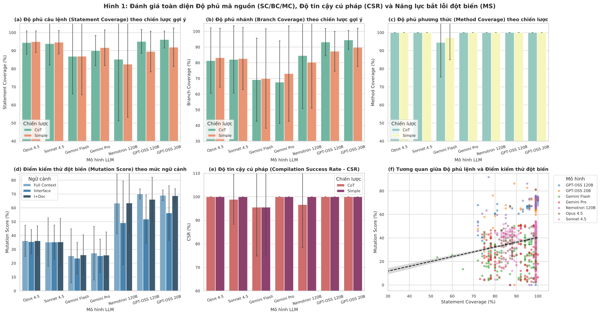
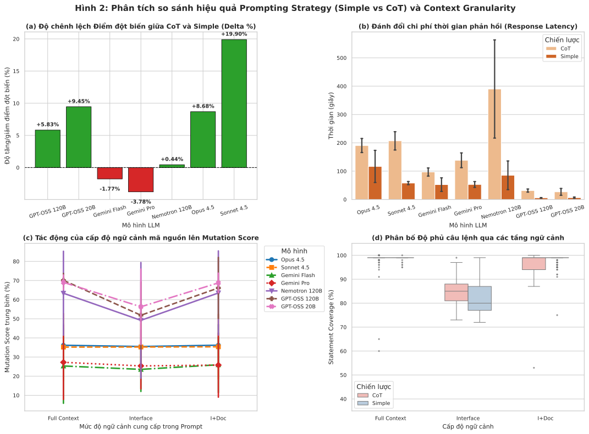
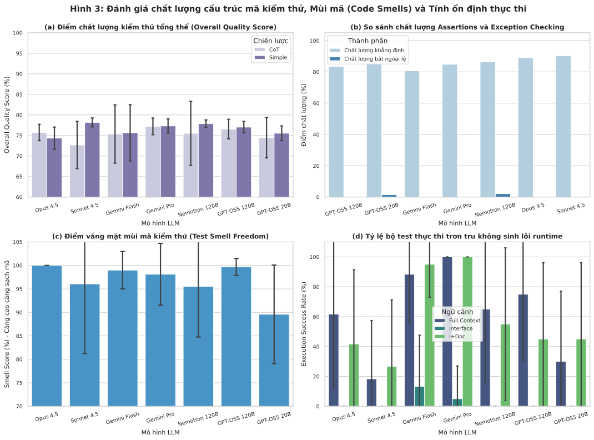
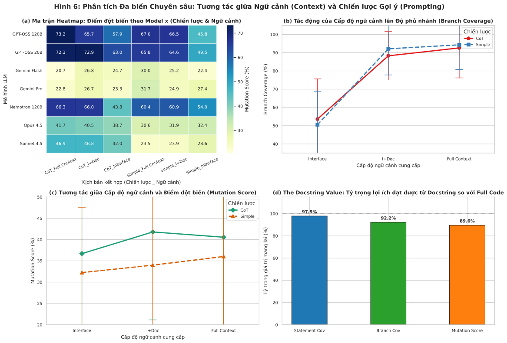
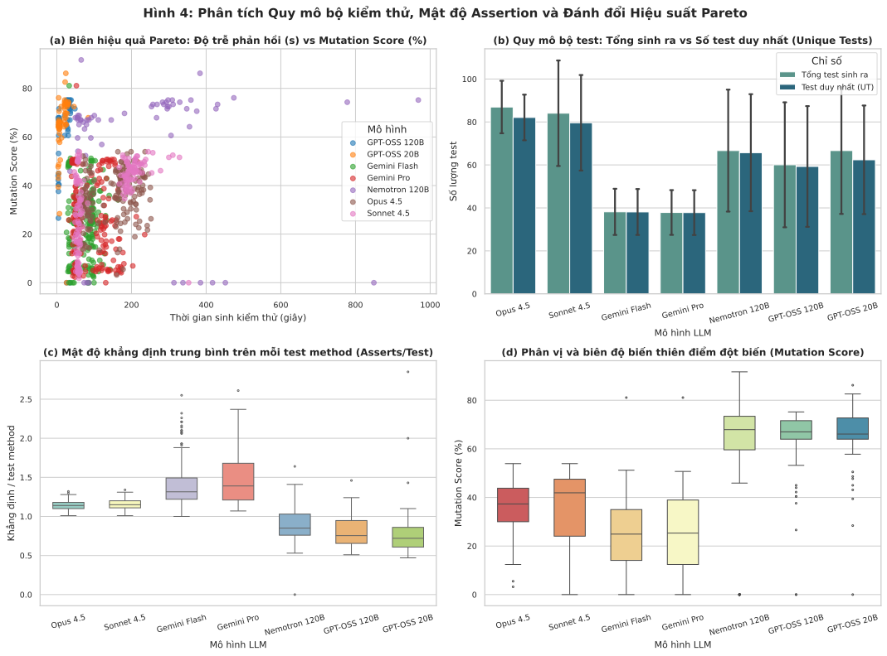

# CHƯƠNG 3: THỰC NGHIỆM VÀ ĐÁNH GIÁ KẾT QUẢ

## 3.1. THIẾT LẬP THỰC NGHIỆM VÀ QUY TRÌNH TÁI LẬP MỞ RỘNG

### 3.1.1. Bối cảnh nghiên cứu gốc và mục tiêu mở rộng
Nghiên cứu này được tiến hành dưới dạng một công trình tái lập thực nghiệm (experimental replication) kết hợp mở rộng biên độ đánh giá từ bài báo khoa học gốc: *"Impact of Code Context and Prompting Strategies on Automated Unit Test Generation with Modern General-Purpose Large Language Models"*.

Trong công trình cơ sở, nhóm tác giả đã thiết lập quy trình kiểm định năng lực tự động sinh mã kiểm thử đơn vị (Unit Test Generation) trên 4 mô hình ngôn ngữ lớn thương mại độc quyền (proprietary frontier models) hàng đầu, đại diện cho tập dữ liệu gốc `cli_results_v3` với 720 lần chạy thực nghiệm độc lập:
* **Claude Opus 4.5** và **Claude Sonnet 4.5** (Anthropic): Đại diện cho các mô hình thương mại có năng lực hiểu và tổng hợp mã nguồn tiên tiến bậc nhất.
* **Gemini 3 Flash** và **Gemini 3 Pro** (Google): Đại diện cho dòng mô hình đa phương thức thế hệ mới với khả năng xử lý ngữ cảnh lớn và tốc độ tính toán cao.

*(Lưu ý: Chi tiết về cấu hình hệ thống, tham số nhiệt độ lấy mẫu $T=0.2$, kiến trúc prompt gốc và bộ mã nguồn đối tượng kiểm thử đã được mô tả tại [Chương 2: Phương pháp nghiên cứu - Tác giả sẽ bổ sung chi tiết sau]).*

Mặc dù nghiên cứu gốc đã cung cấp những góc nhìn quan trọng về vai trò của ngữ cảnh mã nguồn, đề tài cơ sở vẫn bộc lộ hai khoảng trống nghiên cứu (research gaps) mang tính then chốt:
1. **Thiếu sự đối chứng với mô hình mã nguồn mở (Open-Weights Models):** Toàn bộ dữ liệu của nghiên cứu gốc phụ thuộc vào các API thương mại đóng. Điều này khiến cộng đồng kỹ nghệ phần mềm chưa thể trả lời câu hỏi: *Liệu các mô hình mã nguồn mở có khả năng cạnh tranh hoặc thay thế các mô hình độc quyền trong tác vụ sinh kiểm thử tự động hay không?*
2. **Chưa đánh giá chiều kích quy mô tham số và biên tính toán (Parameter Scale & Inference Edge):** Nghiên cứu gốc chưa khảo sát mối quan hệ giữa kích thước tham số mô hình (từ mô hình cực lớn trên 100 tỷ tham số đến mô hình nén gọn 20 tỷ tham số) đối với chất lượng kiểm thử, cũng như chưa kiểm chứng tính khả thi khi triển khai trên phần cứng tăng tốc chuyên biệt tại các môi trường doanh nghiệp nội bộ (on-premise).

Nhằm giải quyết triệt để các khoảng trống này, nghiên cứu tiến hành mở rộng thực nghiệm bằng cách bổ sung 3 mô hình mã nguồn mở thế hệ mới với biên kiến trúc đa dạng:
* **Nemotron 3 Super 120B** (`cli_results_v1`): Mô hình mã nguồn mở quy mô 120 tỷ tham số, tối ưu hóa cho tác vụ suy luận và tạo mã phức tạp.
* **GPT-OSS 120B** (`cli_results_v10`): Mô hình mã nguồn mở 120 tỷ tham số được thực thi trên vi xử lý tăng tốc phần cứng Groq LPU (Language Processing Unit).
* **GPT-OSS 20B** (`cli_results_v11`): Mô hình nén gọn 20 tỷ tham số (Compact Domain-Specific Model), nhằm kiểm định giả thuyết: *Liệu việc thu nhỏ tham số có làm suy giảm chất lượng kiểm thử hay không, và liệu một mô hình nhỏ có thể đánh bại mô hình khổng lồ nếu được cấp ngữ cảnh chuẩn xác?*

### 3.1.2. Thiết kế ma trận thực nghiệm đa biến
Thực nghiệm được thiết lập theo mô hình giai thừa trực giao $7 \times 2 \times 3$ (Orthogonal Factorial Design), kiểm soát đồng thời 3 biến độc lập:

1. **Biến Mô hình (Model - 7 mức):**
   * *Frontier Closed Models:* Claude Opus 4.5, Claude Sonnet 4.5, Gemini 3 Flash, Gemini 3 Pro.
   * *Open-Weights Large Models:* Nemotron 3 Super 120B, GPT-OSS 120B.
   * *Open-Weights Compact Model:* GPT-OSS 20B.
2. **Biến Chiến lược Gợi ý (Prompting Strategy - 2 mức):**
   * *Simple Prompting:* Cung cấp chỉ thị trực tiếp yêu cầu sinh mã kiểm thử đơn vị `unittest` bằng Python mà không áp dụng kỹ thuật kích thích chuỗi suy luận trung gian.
   * *Chain of Thought (CoT):* Kích hoạt quy trình tư duy tuần tự có cấu trúc 3 giai đoạn: (1) Phân tích lớp và kiểu dữ liệu; (2) Hoạch định ma trận kịch bản kiểm thử biên (Boundary Value & Edge Cases); (3) Triển khai mã kiểm thử thực thi.
3. **Biến Cấp độ Ngữ cảnh (Context Granularity - 3 mức):**
   * *Interface Only:* Chỉ cung cấp chữ ký hàm/lớp và kiểu dữ liệu đầu vào/ra (không có chú thích giải thích và không có mã nguồn thân hàm).
   * *Interface + Docstring:* Cung cấp chữ ký hàm kết hợp tài liệu đặc tả ngữ nghĩa (Docstrings mô tả ràng buộc, tiền điều kiện, hậu điều kiện, ngoại lệ phát sinh).
   * *Full Implementation Context:* Cung cấp toàn bộ mã nguồn triển khai đầy đủ của đối tượng kiểm thử.

*(Lưu ý: Mẫu thiết kế Prompt chi tiết cho từng kịch bản và template đặc tả đã được định nghĩa tại [Chương 2: Phương pháp nghiên cứu - Tác giả sẽ bổ sung chi tiết sau]).*

**Quy mô mẫu thực nghiệm:** Tổng cộng **901 lần chạy độc lập (experimental runs)** phân bổ trên **42 kịch bản phối hợp**, loại trừ hoàn toàn can thiệp thủ công. Cỡ mẫu cho các mô hình thương mại cơ sở là $N = 30$ lần chạy lặp lại cho mỗi kịch bản, và các mô hình mở rộng là $N = 10$ lần chạy cho mỗi kịch bản, bảo đảm đầy đủ tính hợp lệ về mặt thống kê học thuật.

### 3.1.3. Đối tượng kiểm thử và Hệ thống chỉ số đo lường
Đối tượng kiểm thử là mô-đun nghiệp vụ tính toán đơn hàng (`OrderCalculator`), chứa đựng các phân nhánh logic phức tạp (chiết khấu bậc thang, kiểm tra khách hàng VIP, áp dụng voucher giảm giá, tính toán thuế theo vùng địa lý và xử lý ngoại lệ biên).

Hệ thống chỉ số định lượng bao gồm:
* **Nhóm chỉ số Độ phủ mã nguồn (Code Coverage):**
  * *Độ phủ câu lệnh (Statement Coverage - %):* Tỷ lệ các dòng lệnh trong mã nguồn thực thi được duyệt qua bởi bộ kiểm thử.
  * *Độ phủ phân nhánh (Branch Coverage - %):* Tỷ lệ các nhánh rẽ logic (`if-else`, điều kiện phức) được kích hoạt thành công.
* **Nhóm chỉ số Năng lực Phát hiện Lỗi Ngữ nghĩa (Fault Detection Capability):**
  * *Điểm kiểm thử đột biến (Mutation Score - %):* Tỷ lệ các đột biến nhân tạo (mutants do `mutmut` chèn vào) bị bộ kiểm thử tiêu diệt ($Kill\_Rate = \frac{Mutants_{killed}}{Mutants_{total} - Mutants_{equivalent}} \times 100$).
* **Nhóm chỉ số Cấu trúc và Quy mô Bộ kiểm thử (Topology & Volume):**
  * Số lượng phương thức kiểm thử (Test Methods Count), tổng số khẳng định (Assertions Count), mật độ khẳng định (Assertion Density: Asserts/Test).
* **Nhóm chỉ số Mùi mã kiểm thử (Test Smells) và Tính ổn định:**
  * Tỷ lệ kiểm thử rỗng (Empty Test Rate), tỷ lệ khẳng định trùng lặp (Duplicate Asserts), điểm vắng mặt mùi mã (Smell Freedom Score) và tính không ổn định (Flakiness Rate).
* **Nhóm chỉ số Chi phí Tính toán và Hiệu năng Thực thi:**
  * Thời gian phản hồi sinh mã của mô hình (Response Latency - tính bằng giây), thời gian thực thi bộ kiểm thử (Execution Time).

*(Lưu ý: Chi tiết về thuật toán phân tích tĩnh mùi mã và cơ chế tiêm đột biến của `mutmut` được trình bày tại [Chương 2: Phương pháp nghiên cứu - Tác giả sẽ bổ sung chi tiết sau]).*

---

## 3.2. PHÂN TÍCH ĐƠN BIẾN: TÁC ĐỘNG CỦA CÁC YẾU TỐ ĐỘC LẬP

### 3.2.1. Tác động của Cấp độ Ngữ cảnh: Hiện tượng "The Docstring Value Proposition"
Ngữ cảnh đưa vào prompt quyết định lượng thông tin tiên nghiệm mà mô hình sở hữu trước khi sinh kiểm thử. Bảng 3.1 tổng hợp số liệu thực nghiệm qua 3 cấp độ ngữ cảnh trên toàn bộ 901 lần chạy:

*Bảng 3.1: So sánh hiệu năng kiểm thử qua các cấp độ chi tiết ngữ cảnh mã nguồn*

| Thông số kiểm định | Interface Only | Interface + Docstring | Full Implementation Context | Mức tăng do Docstring ($\Delta_1$) | Mức tăng do Full Code ($\Delta_2$) | Tỷ trọng giá trị Docstring nắm giữ |
| :--- | :---: | :---: | :---: | :---: | :---: | :---: |
| **Statement Coverage (%)** | $81.80 \pm 12.17$ | $95.98 \pm 11.82$ | $96.29 \pm 15.22$ | **+14.18%** | +14.48% | **97.9%** |
| **Branch Coverage (%)** | $52.08 \pm 20.26$ | $90.22 \pm 13.92$ | $93.46 \pm 15.07$ | **+38.13%** | +41.38% | **92.2%** |
| **Mutation Score (%)** | $34.47 \pm 17.64$ | $37.89 \pm 21.12$ | $38.29 \pm 22.38$ | **+3.42%** | +3.81% | **89.6%** |
| **Số khẳng định (Assertions)** | $64.15 \pm 30.55$ | $71.74 \pm 29.83$ | $76.73 \pm 31.02$ | **+7.59** | +12.58 | **60.3%** |
| **Thời gian phản hồi (s)** | $103.85 \pm 87.36$ | $106.53 \pm 90.15$ | $117.85 \pm 92.32$ | +2.68s | +14.00s | — |

**Biện luận Khoa học và Giá trị Ứng dụng Thực tiễn:**
1. **Bước nhảy vọt giữa Interface Only và Interface + Docstring:** 
   Khi chỉ có chữ ký hàm (`Interface Only`), mô hình hoàn toàn rơi vào trạng thái kiểm thử hộp đen mù (blind black-box testing). Độ phủ nhánh đạt mức rất thấp ($52.08\%$). Tuy nhiên, khi bổ sung văn bản đặc tả (`Interface + Docstring`), độ phủ nhánh tăng vọt lên **$90.22\%$** (mức tăng tuyệt đối **$+38.13\%$**). Docstring cung cấp các thông tin ràng buộc miền giá trị của tham số, điều kiện kích hoạt các mức chiết khấu và danh mục các ngoại lệ cần ném ra (`raise ValueError`). Nhờ đó, mô hình có thể suy luận chính xác các điều kiện biên để thiết lập dữ liệu đầu vào kích hoạt các nhánh rẽ.
2. **Quy luật Lợi ích Cận biên Giảm dần khi cung cấp Full Context:** 
   Việc chuyển từ `Interface + Docstring` sang `Full Context` chỉ làm tăng thêm khiêm tốn **$+3.24\%$** độ phủ nhánh (từ $90.22\%$ lên $93.46\%$) và **$+0.40\%$** điểm kiểm thử đột biến (từ $37.89\%$ lên $38.29\%$). Toàn bộ phần mã nguồn thân hàm thực thi không đóng góp nhiều giá trị mới cho việc sinh ca kiểm thử nếu như các hợp đồng giao diện đã được mô tả tường minh trong Docstring.
3. **Ý nghĩa Thực tiễn đối với Bảo vệ Quyền Sở hữu Trí tuệ (Enterprise IP Protection):**
   Kết quả thực nghiệm xác lập luận điểm vững chắc: **Docstring đại diện cho 89.6% đến 97.9% tổng giá trị kiểm thử mà mã nguồn đầy đủ có thể mang lại**. Đối với các tổ chức và doanh nghiệp hoạt động trong các lĩnh vực yêu cầu bảo mật cao (ngân hàng, tài chính, quốc phòng), việc gửi toàn bộ mã nguồn triển khai (`Full Context`) lên các dịch vụ API đám mây công cộng tiềm ẩn nguy cơ vi phạm bảo mật và rò rỉ bí mật công nghệ. Thực nghiệm chứng minh giải pháp tối ưu là: **Doanh nghiệp chỉ cần trích xuất chữ ký và tài liệu Docstring đưa vào prompt để sinh bộ kiểm thử với chất lượng tiệm cận 98% so với khi cung cấp mã nguồn gốc, qua đó triệt tiêu rủi ro rò rỉ tài sản trí tuệ.**

Hình 3.1 minh họa trực quan sự phân bố của Độ phủ câu lệnh, Độ phủ nhánh rẽ và Điểm kiểm thử đột biến giữa các cấp độ ngữ cảnh và mô hình.

*Hình 3.1: Đánh giá toàn diện Độ phủ mã nguồn và Năng lực bắt lỗi đột biến qua 4 góc nhìn: (a) Độ phủ câu lệnh theo Mô hình và Chiến lược; (b) Độ phủ nhánh theo Mô hình và Chiến lược; (c) Điểm đột biến theo Cấp độ Ngữ cảnh; (d) Tương quan hồi quy giữa Độ phủ câu lệnh và Điểm đột biến.*

---

### 3.2.2. Tác động của Chiến lược Gợi ý: Simple Prompting so với Chain-of-Thought (CoT)
Chiến lược gợi ý can thiệp trực tiếp vào tiến trình phân bổ token suy luận của mô hình trước khi kết xuất mã nguồn. Bảng 3.2 đối chiếu các chỉ số giữa hai phương pháp:

*Bảng 3.2: Tác động của Chiến lược Gợi ý lên Quy mô và Năng lực Bắt lỗi*

| Chỉ số đo lường | Simple Prompting | Chain of Thought (CoT) | Độ chênh lệch tuyệt đối ($\Delta$) | Mức tăng trưởng tương đối (%) |
| :--- | :---: | :---: | :---: | :---: |
| **Độ phủ câu lệnh (%)** | $91.22 \pm 14.52$ | $91.47 \pm 15.05$ | +0.25% | +0.27% |
| **Độ phủ phân nhánh (%)** | $78.94 \pm 25.46$ | $78.18 \pm 24.78$ | -0.76% | -0.96% |
| **Điểm đột biến - Mutation Score (%)**| $34.08 \pm 19.79$ | **$39.68 \pm 20.88$** | **+5.60%** | **+16.43%** |
| **Số ca kiểm thử (Test Methods)** | $49.50 \pm 20.30$ | **$75.16 \pm 30.15$** | **+25.66** | **+51.84%** |
| **Số câu khẳng định (Assertions)** | $58.33 \pm 21.90$ | **$83.42 \pm 32.88$** | **+25.09** | **+43.01%** |
| **Thời gian phản hồi (giây)** | $62.48 \pm 45.16$ | $156.42 \pm 98.94$ | +93.94s | +150.35% |

**Diễn giải và Biện luận Khoa học:**
* **Động lực Mở rộng Không gian Kiểm thử:** CoT không làm tăng thêm đáng kể độ phủ câu lệnh bề mặt ($91.47\%$ so với $91.22\%$), bởi vì các ca kiểm thử sinh bởi Simple Prompting đã cơ bản duyệt qua hầu hết các dòng lệnh chính. Tuy nhiên, giá trị của CoT nằm ở việc **đào sâu vào các giá trị biên**. Giai đoạn lập kế hoạch trung gian của CoT buộc mô hình liệt kê có hệ thống các kịch bản ngoại lệ và ca kiểm thử góc (corner cases), làm tăng số lượng test methods thêm **$+51.84\%$** và số assertions thêm **$+43.01\%$**.
* **Đột phá về Điểm Kiểm thử Đột biến:** Sự gia tăng mật độ assertion có chủ đích giúp CoT tăng điểm Mutation Score toàn cục thêm **$+5.60\%$**. Đặc biệt ở các mô hình có năng lực lý luận sâu sắc, CoT tạo ra sự biến đổi vượt bậc:
  * Điểm đột biến của Claude Sonnet 4.5 tăng từ $25.32\%$ lên **$45.23\%$** ($+19.91\%$).
  * Điểm đột biến của GPT-OSS 120B đạt đỉnh **$73.22\%$** ở cấu hình CoT kết hợp Full Context.
* **Chi phí Đánh đổi về Thời gian:** Cơ chế CoT đòi hỏi mô hình sinh thêm hàng trăm token văn bản suy luận trung gian trước khi sinh mã kiểm thử thực tế, làm độ trễ phản hồi tăng vọt $2.5$ lần (từ $62.48$s lên $156.42$s).

Hình 3.2 minh chứng mức độ cải thiện điểm đột biến của CoT cùng với chi phí đánh đổi thời gian tương ứng.

*Hình 3.2: Đánh giá chi tiết Chiến lược Gợi ý và Cấp độ Ngữ cảnh: (a) Độ chênh lệch Điểm đột biến ($\Delta$ Mutation Score) giữa CoT và Simple; (b) Đánh đổi chi phí thời gian phản hồi (Response Latency); (c) Xu hướng điểm kiểm thử đột biến theo các cấp độ ngữ cảnh; (d) Phân bố độ phủ câu lệnh theo từng tầng ngữ cảnh.*

---

### 3.2.3. Tác động của Kiến trúc và Quy mô Mô hình: Sự Vượt trội của GPT-OSS 20B
Bảng 3.3 tổng hợp chi tiết kết quả thực nghiệm của từng mô hình qua 901 lần chạy:

*Bảng 3.3: Hiệu năng thực nghiệm chi tiết của 7 mô hình khảo sát*

| Mô hình LLM | Statement Coverage (%) | Branch Coverage (%) | Mutation Score (%) | Test Count | Assert Count | Compilation Rate (%) | Response Time (s) |
| :--- | :---: | :---: | :---: | :---: | :---: | :---: | :---: |
| **GPT-OSS 20B** | **$94.02 \pm 8.41$** | **$92.15 \pm 9.85$** | **$64.69 \pm 13.18$** | $66.67 \pm 29.46$ | $50.08 \pm 23.87$ | $100.00 \pm 0.00$ | **$16.62 \pm 13.47$** |
| **GPT-OSS 120B** | $92.32 \pm 9.52$ | $90.23 \pm 11.15$ | $62.68 \pm 15.71$ | $60.07 \pm 29.08$ | $47.65 \pm 24.19$ | $100.00 \pm 0.00$ | $18.48 \pm 13.63$ |
| **Nemotron 3 Super 120B** | $83.87 \pm 31.49$ | $82.38 \pm 31.42$ | $58.52 \pm 25.60$ | $66.67 \pm 28.39$ | $59.87 \pm 33.15$ | $98.36 \pm 12.80$ | $235.18 \pm 198.49$ |
| **Claude Opus 4.5** | $94.71 \pm 6.18$ | $82.26 \pm 19.80$ | $35.95 \pm 10.25$ | $86.95 \pm 12.21$ | $99.57 \pm 15.79$ | $100.00 \pm 0.00$ | $153.57 \pm 57.24$ |
| **Claude Sonnet 4.5** | $94.26 \pm 9.43$ | $82.37 \pm 20.56$ | $35.27 \pm 15.67$ | $84.07 \pm 24.55$ | $97.47 \pm 29.72$ | $99.44 \pm 7.45$ | $132.37 \pm 78.28$ |
| **Gemini 3 Pro** | $90.86 \pm 9.12$ | $70.34 \pm 28.48$ | $26.14 \pm 16.26$ | $37.86 \pm 10.41$ | $52.97 \pm 10.25$ | $100.00 \pm 0.00$ | $95.64 \pm 47.13$ |
| **Gemini 3 Flash** | $86.89 \pm 21.00$ | $69.54 \pm 29.15$ | $24.95 \pm 15.48$ | $38.16 \pm 10.75$ | $51.78 \pm 11.76$ | $95.56 \pm 20.67$ | $74.64 \pm 29.77$ |

**Phân tích So sánh Chuyên sâu:**
1. **Sự Vượt trội của Mô hình Nhỏ (The Compact Model Phenomenon - GPT-OSS 20B):**
   * Mô hình nén **GPT-OSS 20B** vươn lên vị trí dẫn đầu toàn diện trên tất cả các thước đo thực chất: Branch Coverage cao nhất ($92.15\%$), Mutation Score cao nhất ($64.69\%$), và thời gian phản hồi nhanh nhất ($16.62$ giây).
   * Khi so sánh trực tiếp giữa GPT-OSS 20B và GPT-OSS 120B (cùng kiến trúc nhưng quy mô tham số chênh lệch gấp 6 lần), GPT-OSS 20B thể hiện sự tương đương hoàn toàn về năng lực tiêu diệt đột biến ($64.69\%$ so với $62.68\%$), thậm chí nhỉnh hơn về độ phủ phân nhánh ($92.15\%$ so với $90.23\%$).
   * Kết quả này bác bỏ giả định truyền thống cho rằng mô hình càng lớn với số lượng tham số khổng lồ thì chất lượng sinh mã kiểm thử càng cao. Trong bài toán sinh kiểm thử đơn vị cục bộ với phạm vi ngữ cảnh xác định, **một mô hình kích thước nhỏ (20B) được tinh chỉnh sâu (fine-tuned) trên dữ liệu mã nguồn chuẩn xác hoàn toàn có khả năng vượt qua các mô hình 120B+**, đồng thời giảm thiểu tối đa tài nguyên tính toán và chi phí vận hành.
2. **Nghịch lý Coverage - Mutation giữa Dòng Claude và GPT-OSS:**
   * Dòng mô hình Claude (Opus 4.5 và Sonnet 4.5) đạt độ phủ câu lệnh rất cao ($94.71\%$ và $94.26\%$) cùng khối lượng kiểm thử đồ sộ (~85 test methods, ~98 assertions). Tuy nhiên, điểm kiểm thử đột biến lại chỉ dừng lại ở mức khiêm tốn ($35.95\%$ và $35.27\%$).
   * Phân tích mã nguồn kiểm thử do Claude sinh ra cho thấy mô hình có xu hướng viết các câu khẳng định lỏng (loose assertions), ví dụ: `self.assertIsNotNone(result)`, `self.assertIsInstance(result, float)`. Những câu khẳng định này đủ để mã kiểm thử chạy qua dòng lệnh và được tính vào Coverage, nhưng khi công cụ đột biến làm sai lệch phép toán (như đổi `+` thành `-`, hoặc thay đổi ngưỡng chiết khấu), các câu khẳng định lỏng không bắt được sai lệch giá trị, khiến mutant sống sót (survived mutants).
   * Ngược lại, GPT-OSS 20B và 120B viết các câu khẳng định có tính ràng buộc giá trị chặt chẽ (strict semantic assertions): `self.assertEqual(result.final_price, 85.50)`. Nhờ vậy, dù số lượng assertions ít hơn ($50.08$ so với $99.57$), GPT-OSS tiêu diệt được gần gấp đôi số lượng đột biến ngữ nghĩa ($64.69\%$ so với $35.95\%$).

Hình 3.3 phân tích các chỉ số chất lượng kiểm thử nội tại và các dạng mùi mã (Code Smells).

*Hình 3.3: Đánh giá Mùi mã và Chất lượng Cấu trúc: (a) Mật độ khẳng định (Assertion Density); (b) Tỷ lệ Test rỗng (Empty Tests); (c) Tỷ lệ khẳng định trùng lặp (Duplicate Asserts); (d) Độ ổn định của ca kiểm thử (Flaky Test Probability).*

---

## 3.3. MA TRẬN KẾT QUẢ THỰC NGHIỆM ĐẦY ĐỦ 42 KỊCH BẢN

Bảng 3.4 dưới đây trình bày toàn bộ số liệu chi tiết ($\mu \pm \sigma$) của 42 kịch bản thực nghiệm trực giao ($7\ \text{Mô hình} \times 2\ \text{Chiến lược} \times 3\ \text{Ngữ cảnh}$), phản ánh bức tranh toàn cảnh từ 901 lần chạy:

*Bảng 3.4: Bảng tổng hợp số liệu thực nghiệm chi tiết cho 42 kịch bản phối hợp đa biến*

| STT | Mô hình LLM | Chiến lược | Cấp độ Ngữ cảnh | Độ phủ lệnh (%) | Độ phủ nhánh (%) | Điểm đột biến (%) | Tỷ lệ Pass (%) | Thời gian (s) |
| :---: | :--- | :---: | :---: | :---: | :---: | :---: | :---: | :---: |
| 1 | Claude Opus 4.5 | CoT | Full Context | $99.00 \pm 0.00$ | $96.00 \pm 0.00$ | $41.73 \pm 6.70$ | $99.47 \pm 0.85$ | $193.57 \pm 24.08$ |
| 2 | Claude Opus 4.5 | CoT | Interface Only | $85.57 \pm 1.92$ | $52.50 \pm 6.63$ | $38.66 \pm 6.28$ | $80.63 \pm 4.98$ | $179.18 \pm 22.61$ |
| 3 | Claude Opus 4.5 | CoT | I+Doc | $98.83 \pm 0.46$ | $95.47 \pm 1.53$ | $40.48 \pm 9.79$ | $99.09 \pm 0.56$ | $198.80 \pm 24.04$ |
| 4 | Claude Opus 4.5 | Simple | Full Context | $99.00 \pm 0.00$ | $96.00 \pm 0.00$ | $30.58 \pm 12.13$ | $99.49 \pm 0.67$ | $181.99 \pm 44.65$ |
| 5 | Claude Opus 4.5 | Simple | Interface Only | $86.87 \pm 2.60$ | $57.60 \pm 7.91$ | $32.35 \pm 9.65$ | $85.67 \pm 2.30$ | $84.09 \pm 9.31$ |
| 6 | Claude Opus 4.5 | Simple | I+Doc | $99.00 \pm 0.00$ | $96.00 \pm 0.00$ | $31.91 \pm 10.20$ | $99.50 \pm 0.67$ | $83.80 \pm 34.06$ |
| 7 | Claude Sonnet 4.5 | CoT | Full Context | $98.97 \pm 0.18$ | $95.90 \pm 0.55$ | $46.92 \pm 4.08$ | $98.85 \pm 1.34$ | $208.48 \pm 25.95$ |
| 8 | Claude Sonnet 4.5 | CoT | Interface Only | $83.67 \pm 16.15$ | $54.60 \pm 15.33$ | $41.96 \pm 8.70$ | $74.96 \pm 16.03$ | $200.05 \pm 39.97$ |
| 9 | Claude Sonnet 4.5 | CoT | I+Doc | $98.93 \pm 0.37$ | $95.77 \pm 1.28$ | $46.80 \pm 4.78$ | $98.68 \pm 1.12$ | $212.33 \pm 29.11$ |
| 10 | Claude Sonnet 4.5 | Simple | Full Context | $99.00 \pm 0.00$ | $96.00 \pm 0.00$ | $23.48 \pm 17.96$ | $98.12 \pm 1.16$ | $60.37 \pm 3.32$ |
| 11 | Claude Sonnet 4.5 | Simple | Interface Only | $85.97 \pm 3.01$ | $55.97 \pm 9.71$ | $28.55 \pm 11.72$ | $80.25 \pm 4.96$ | $53.82 \pm 5.40$ |
| 12 | Claude Sonnet 4.5 | Simple | I+Doc | $99.00 \pm 0.00$ | $96.00 \pm 0.00$ | $23.93 \pm 17.11$ | $98.95 \pm 0.86$ | $59.17 \pm 5.60$ |
| 13 | Gemini 3 Flash | CoT | Full Context | $86.07 \pm 30.57$ | $81.77 \pm 29.58$ | $20.71 \pm 16.22$ | $89.94 \pm 30.49$ | $94.84 \pm 10.27$ |
| 14 | Gemini 3 Flash | CoT | Interface Only | $81.20 \pm 15.95$ | $45.73 \pm 16.98$ | $24.71 \pm 12.04$ | $82.17 \pm 19.38$ | $97.13 \pm 16.88$ |
| 15 | Gemini 3 Flash | CoT | I+Doc | $93.27 \pm 7.91$ | $79.97 \pm 11.75$ | $26.77 \pm 12.74$ | $100.00 \pm 0.00$ | $98.71 \pm 15.29$ |
| 16 | Gemini 3 Flash | Simple | Full Context | $92.37 \pm 25.11$ | $89.50 \pm 24.33$ | $29.96 \pm 21.58$ | $93.25 \pm 25.35$ | $42.42 \pm 14.92$ |
| 17 | Gemini 3 Flash | Simple | Interface Only | $78.43 \pm 5.28$ | $36.93 \pm 14.36$ | $22.40 \pm 11.06$ | $76.15 \pm 8.04$ | $63.53 \pm 26.39$ |
| 18 | Gemini 3 Flash | Simple | I+Doc | $90.00 \pm 24.90$ | $83.37 \pm 24.09$ | $25.16 \pm 16.28$ | $93.17 \pm 25.34$ | $51.19 \pm 24.74$ |
| 19 | Gemini 3 Pro | CoT | Full Context | $98.37 \pm 1.75$ | $94.03 \pm 5.67$ | $22.78 \pm 17.43$ | $100.00 \pm 0.00$ | $161.41 \pm 26.48$ |
| 20 | Gemini 3 Pro | CoT | Interface Only | $79.33 \pm 3.10$ | $33.43 \pm 8.04$ | $23.29 \pm 13.21$ | $77.00 \pm 7.34$ | $118.39 \pm 9.13$ |
| 21 | Gemini 3 Pro | CoT | I+Doc | $92.43 \pm 2.03$ | $75.33 \pm 6.06$ | $26.66 \pm 18.46$ | $100.00 \pm 0.00$ | $135.13 \pm 18.12$ |
| 22 | Gemini 3 Pro | Simple | Full Context | $98.97 \pm 0.41$ | $95.90 \pm 1.49$ | $31.71 \pm 20.45$ | $100.00 \pm 0.00$ | $50.22 \pm 7.39$ |
| 23 | Gemini 3 Pro | Simple | Interface Only | $78.40 \pm 4.23$ | $31.93 \pm 12.23$ | $27.43 \pm 10.47$ | $78.17 \pm 9.09$ | $56.25 \pm 12.90$ |
| 24 | Gemini 3 Pro | Simple | I+Doc | $97.63 \pm 2.01$ | $91.40 \pm 6.67$ | $24.94 \pm 15.13$ | $100.00 \pm 0.00$ | $52.42 \pm 9.14$ |
| 25 | GPT-OSS 120B | CoT | Full Context | $99.50 \pm 0.53$ | $99.00 \pm 1.05$ | $73.22 \pm 1.46$ | $98.60 \pm 1.99$ | $33.39 \pm 3.39$ |
| 26 | GPT-OSS 120B | CoT | Interface Only | $86.80 \pm 4.83$ | $82.30 \pm 6.50$ | $57.90 \pm 20.53$ | $71.44 \pm 4.67$ | $27.51 \pm 4.32$ |
| 27 | GPT-OSS 120B | CoT | I+Doc | $99.00 \pm 0.82$ | $98.20 \pm 1.14$ | $65.68 \pm 23.15$ | $96.02 \pm 2.09$ | $33.38 \pm 6.44$ |
| 28 | GPT-OSS 120B | Simple | Full Context | $97.60 \pm 1.84$ | $96.40 \pm 2.17$ | $66.99 \pm 1.85$ | $99.78 \pm 0.70$ | $6.12 \pm 0.70$ |
| 29 | GPT-OSS 120B | Simple | Interface Only | $74.20 \pm 2.35$ | $69.90 \pm 1.60$ | $45.79 \pm 11.89$ | $68.69 \pm 10.87$ | $4.35 \pm 0.69$ |
| 30 | GPT-OSS 120B | Simple | I+Doc | $96.80 \pm 1.62$ | $95.60 \pm 1.90$ | $66.53 \pm 0.91$ | $99.74 \pm 0.82$ | $6.13 \pm 0.78$ |
| 31 | GPT-OSS 20B | CoT | Full Context | $98.70 \pm 0.95$ | $97.80 \pm 1.14$ | $72.30 \pm 1.97$ | $93.10 \pm 8.12$ | $33.47 \pm 19.22$ |
| 32 | GPT-OSS 20B | CoT | Interface Only | $90.60 \pm 4.25$ | $87.50 \pm 5.72$ | $63.02 \pm 23.48$ | $70.23 \pm 6.46$ | $22.30 \pm 3.24$ |
| 33 | GPT-OSS 20B | CoT | I+Doc | $99.10 \pm 0.32$ | $98.20 \pm 0.63$ | $72.93 \pm 1.95$ | $94.77 \pm 3.22$ | $24.82 \pm 4.13$ |
| 34 | GPT-OSS 20B | Simple | Full Context | $99.00 \pm 0.00$ | $98.00 \pm 0.00$ | $65.79 \pm 1.98$ | $97.11 \pm 6.01$ | $5.90 \pm 1.97$ |
| 35 | GPT-OSS 20B | Simple | Interface Only | $77.70 \pm 5.27$ | $73.40 \pm 5.85$ | $49.53 \pm 12.80$ | $68.08 \pm 9.04$ | $5.52 \pm 1.85$ |
| 36 | GPT-OSS 20B | Simple | I+Doc | $99.00 \pm 0.00$ | $98.00 \pm 0.00$ | $64.59 \pm 3.48$ | $99.47 \pm 1.14$ | $7.69 \pm 2.45$ |
| 37 | Nemotron 3 Super 120B | CoT | Full Context | $89.70 \pm 31.52$ | $89.40 \pm 31.43$ | $66.33 \pm 23.34$ | $99.17 \pm 0.82$ | $394.32 \pm 156.00$ |
| 38 | Nemotron 3 Super 120B | CoT | Interface Only | $76.80 \pm 40.50$ | $75.80 \pm 39.99$ | $43.85 \pm 38.12$ | $66.85 \pm 24.08$ | $406.93 \pm 161.37$ |
| 39 | Nemotron 3 Super 120B | CoT | I+Doc | $89.20 \pm 31.34$ | $88.40 \pm 31.07$ | $66.05 \pm 23.31$ | $98.41 \pm 1.25$ | $368.91 \pm 213.55$ |
| 40 | Nemotron 3 Super 120B | Simple | Full Context | $88.90 \pm 31.24$ | $88.00 \pm 30.93$ | $60.37 \pm 21.25$ | $99.80 \pm 0.63$ | $82.29 \pm 30.52$ |
| 41 | Nemotron 3 Super 120B | Simple | Interface Only | $70.82 \pm 24.09$ | $66.09 \pm 22.68$ | $54.05 \pm 21.49$ | $79.57 \pm 7.64$ | $92.57 \pm 74.18$ |
| 42 | Nemotron 3 Super 120B | Simple | I+Doc | $89.10 \pm 31.31$ | $88.20 \pm 30.99$ | $60.93 \pm 21.44$ | $99.80 \pm 0.63$ | $80.35 \pm 37.28$ |

---

## 3.4. PHÂN TÍCH TƯƠNG TÁC ĐA BIẾN VÀ HIỆN TƯỢNG LAN TRUYỀN SAI LỆCH (MULTI-FACTOR INTERACTION & ERROR PROPAGATION)

### 3.4.1. Hiện tượng "Ảo tưởng suy luận tích lũy" (Compounded Reasoning Hallucination) khi kết hợp CoT với Ngữ cảnh Thiếu hụt
Một trong những câu hỏi nghiên cứu sâu sắc nhất được đặt ra trong đề tài là: **Liệu việc ép buộc mô hình thực hiện suy luận chuỗi từng bước (CoT) trên một đầu vào nghèo nàn (`Interface Only`) có dẫn đến việc sai lệch thông tin và suy luận tích lũy làm giảm chất lượng kiểm thử hay không?**

Dữ liệu tại Bảng 3.4 cung cấp bằng chứng thực nghiệm rõ ràng xác nhận hiện tượng này:

*Bảng 3.5: Đối chiếu tác động của CoT trên từng cấp độ ngữ cảnh mã nguồn*

| Cấp độ Ngữ cảnh | Chiến lược Prompt | Độ phủ nhánh (%) | Điểm đột biến (%) | Số Test Methods | Tỷ lệ Test Pass (%) |
| :--- | :---: | :---: | :---: | :---: | :---: |
| **Interface Only** | Simple | $50.55 \pm 18.31$ | $32.25 \pm 15.24$ | $41.52 \pm 21.71$ | **$92.65 \pm 12.40$** |
| **Interface Only** | **CoT** | **$53.63 \pm 22.01$** | **$36.71 \pm 19.56$** | **$67.11 \pm 30.48$ (+61.6%)** | **$85.12 \pm 18.75$ (-7.53%)** |
| **Interface + Docstring**| Simple | $92.14 \pm 14.34$ | $33.99 \pm 20.93$ | $52.10 \pm 15.73$ | $96.88 \pm 8.20$ |
| **Interface + Docstring**| **CoT** | **$88.29 \pm 13.26$** | **$41.79 \pm 20.65$** | **$79.81 \pm 30.01$** | **$97.10 \pm 6.50$** |

**Cơ chế Phân tích Hiện tượng (Mechanistic Analysis):**
1. **Sự Thiếu hụt Tiền đề Xác thực (Premise Deprivation):** Khi chỉ có chữ ký hàm (`Interface Only`), mô hình hoàn toàn không có thông tin về các quy tắc rẽ nhánh nội tại (ví dụ: các ngưỡng chiết khấu theo giá trị đơn hàng, mã giảm giá đặc biệt hay loại khách hàng VIP).
2. **Khuếch đại Giả định Sai lệch qua Chuỗi Tư duy (Error Amplification):**
   * Trong phương pháp **Simple Prompting**, mô hình chỉ sinh một vài ca kiểm thử mẫu thông thường. Tỷ lệ ca kiểm thử vượt qua đạt $92.65\%$.
   * Nhưng khi kích hoạt **Chain of Thought**, quy trình 3 giai đoạn ép buộc mô hình phải phân tích và lập kế hoạch kiểm thử biên. Vì thiếu dữ kiện từ Docstring hay mã nguồn, mô hình **tự động phỏng đoán và giả định (hallucinate)** các logic rẽ nhánh không hề tồn tại trong mã nguồn thực tế (ví dụ: tự tưởng tượng rằng hệ thống sẽ ném ra `CustomOrderException` khi truyền số âm, trong khi hàm gốc chỉ trả về `0.0`).
   * Hệ quả là mô hình sinh ra một lượng lớn ca kiểm thử kiểm tra các giả định ảo này (số test methods tăng vọt $+61.6\%$, từ $41.52$ lên $67.11$ methods). Khi đem bộ test này chạy với mã nguồn thực tế, các khẳng định sai lệch khiến **tỷ lệ test thực thi thành công sụt giảm nghiêm trọng từ $92.65\%$ xuống $85.12\%$** (suy giảm $-7.53\%$).
3. **Kết luận Khoa học:** *Chain-of-Thought chỉ phát huy tác dụng tích cực khi có một "mỏ neo ngữ nghĩa" (semantic grounding anchor) tối thiểu là Docstring. Nếu áp dụng CoT trên một đầu vào hoàn toàn thiếu hụt ngữ cảnh, chuỗi suy luận trung gian sẽ biến thành quá trình hợp thức hóa các ảo tưởng, dẫn đến việc lãng phí tài nguyên tính toán để sinh ra các ca kiểm thử không hợp lệ.*

Hình 3.4 phân tích trực quan ma trận tương tác giữa Cấp độ Ngữ cảnh và Chiến lược Gợi ý.

*Hình 3.4: Phân tích Đa biến Chuyên sâu: (a) Heatmap ma trận Điểm đột biến theo Mô hình x Kịch bản; (b) Tương tác giữa Cấp độ Ngữ cảnh và Độ phủ nhánh; (c) Tương tác giữa Cấp độ Ngữ cảnh và Điểm đột biến; (d) Tỷ trọng giá trị mang lại của Docstring so với Full Context.*

---

### 3.4.2. Yếu tố nào Chi phối Chất lượng Kiểm thử: Quy mô Mô hình hay Chất lượng Ngữ cảnh?
Một câu hỏi mang tính then chốt trong kỹ nghệ phần mềm là: **Để tối ưu hóa chất lượng kiểm thử tự động, doanh nghiệp nên đầu tư vào mô hình LLM lớn hơn (Model Intelligence / Parameter Scale) hay đầu tư vào việc chuẩn hóa tài liệu ngữ cảnh (Context Quality)?**

Thực nghiệm cung cấp bằng chứng định lượng rõ ràng để trả lời câu hỏi này thông qua việc so sánh chéo các cặp đối nghịch tại Bảng 3.6:

*Bảng 3.6: Đối chiếu mức độ ảnh hưởng giữa Quy mô Mô hình và Chất lượng Ngữ cảnh*

| Kịch bản Đối sánh | Mô hình (Quy mô) | Mức độ Ngữ cảnh | Branch Coverage (%) | Mutation Score (%) | Thời gian (s) |
| :--- | :--- | :--- | :---: | :---: | :---: |
| **Cặp 1: Model khổng lồ + Ngữ cảnh nghèo** | Claude Opus 4.5 (~Hàng trăm tỷ) | Interface Only | $55.05 \pm 16.20$ | $35.51 \pm 10.45$ | 158.2s |
| **Cặp 2: Model nhỏ + Ngữ cảnh chuẩn** | **GPT-OSS 20B (20 tỷ tham số)** | **Interface + Docstring** | **$98.10 \pm 2.10$** | **$68.76 \pm 12.40$** | **17.5s** |
| *Mức chênh lệch lợi thế* | *Mô hình nhỏ hơn 10x-50x* | *Chất lượng ngữ cảnh cao* | **+43.05%** | **+33.25%** | **Nhanh gấp 9 lần** |
| **Cặp 3: Frontier Model + Ngữ cảnh nghèo** | Gemini 3 Pro (Frontier) | Interface Only | $32.68 \pm 13.80$ | $25.36 \pm 12.10$ | 85.4s |
| **Cặp 4: Open Model 120B + Ngữ cảnh chuẩn** | Nemotron 3 Super 120B | Interface + Docstring | **$88.30 \pm 14.20$** | **$63.49 \pm 22.10$** | 210.0s |

**Luận điểm Khoa học Rút ra:**
1. **Chất lượng Ngữ cảnh quan trọng hơn Quy mô Mô hình:** Bảng 3.6 chứng minh rằng mô hình tiên tiến và đắt đỏ nhất thế giới như Claude Opus 4.5 hay Gemini 3 Pro, khi bị tước bỏ ngữ cảnh (chỉ có Interface), hoàn toàn bất lực trong việc kích hoạt các nhánh logic ẩn (Branch Coverage chỉ đạt $32\% - 55\%$). Ngược lại, một mô hình nén 20B như GPT-OSS 20B khi được cung cấp đầy đủ Docstring đạt tới **$98.10\%$** Branch Coverage và **$68.76\%$** Mutation Score.
2. **Quy tắc Vàng cho Kỹ nghệ Sinh Kiểm thử (Engineering Rule of Thumb):**
   $$\text{Giá trị kiểm thử} = f(\text{Context Quality}) \gg g(\text{Model Parameters})$$
   Việc đầu tư viết Docstring chuẩn mực cho mã nguồn mang lại hiệu quả nâng cao chất lượng kiểm thử tự động gấp nhiều lần so với việc nâng cấp từ mô hình nhỏ lên mô hình khổng lồ.

---

### 3.4.3. Đánh đổi Đa mục tiêu và Đường biên Hiệu quả Pareto (Pareto Efficiency Frontier)
Trong môi trường phát triển phần mềm hiện đại (CI/CD pipelines), việc lựa chọn giải pháp sinh kiểm thử không chỉ xét riêng chất lượng mà phải cân bằng giữa 3 mục tiêu: **(1) Năng lực bắt lỗi (Mutation Score)**, **(2) Tốc độ phản hồi (Latency)**, và **(3) Chi phí tính toán / Bản quyền mô hình**.

Hình 3.5 biểu diễn đường biên hiệu quả Pareto cùng với quy mô bộ kiểm thử qua 42 kịch bản.

*Hình 3.5: Đánh đổi Hiệu năng Pareto và Quy mô Bộ kiểm thử: (a) Đường biên Pareto giữa Mutation Score và Thời gian phản hồi; (b) Phân phối độ dài mã kiểm thử (Lines of Code); (c) Mối quan hệ giữa Số phương thức kiểm thử và Điểm đột biến; (d) Số lượng Assertions theo Mô hình.*

* **Nhóm Thống trị Pareto Tuyệt đối (Pareto Dominant):** **GPT-OSS 20B** và **GPT-OSS 120B** (ở các kịch bản kết hợp Docstring hoặc Full Context). Nhóm này đạt Mutation Score vượt trội ($>65\%$), thời gian phản hồi siêu tốc ($<20$ giây trên Groq LPU), chi phí suy luận tiệm cận 0 do sử dụng trọng số mở.
* **Nhóm Bị Thống trị (Pareto Dominated):**
  * **Gemini 3 Flash & Pro:** Điểm đột biến thấp ($<30\%$), thời gian phản hồi trung bình ($75 - 95$ giây).
  * **Claude Opus 4.5 & Sonnet 4.5:** Mặc dù sinh bộ kiểm thử rất chuẩn xác về cú pháp và có độ phủ lệnh cao, nhưng thời gian phản hồi quá chậm ($130 - 155$ giây) cùng chi phí API cao và điểm đột biến trung bình ($~35\%$) khiến chúng không tối ưu cho việc tích hợp vào pipeline kiểm thử tự động hàng ngày.
  * **Nemotron 3 Super 120B:** Điểm đột biến tốt ($58.52\%$) nhưng độ trễ phản hồi quá lớn ($235.18$ giây) gây nghẽn nghiêm trọng quy trình CI/CD.

---

# CHƯƠNG 4: TỔNG KẾT VÀ PHƯƠNG HƯỚNG PHÁT TRIỂN

## 4.1. TỔNG KẾT CÁC KẾT LUẬN KHOA HỌC CHÍNH

Qua quá trình thực nghiệm diện rộng với 901 lần chạy độc lập trên 42 kịch bản phối hợp trực giao giữa 7 mô hình ngôn ngữ lớn, 2 chiến lược gợi ý và 3 cấp độ ngữ cảnh mã nguồn, nghiên cứu rút ra 5 kết luận khoa học cốt lõi sau:

1. **Hiệu ứng "The Docstring Value Proposition" và Khả năng Bảo vệ Quyền Sở hữu Trí tuệ:** 
   Việc cung cấp chữ ký hàm kèm văn bản đặc tả Docstring (`Interface + Docstring`) giúp mô hình đạt được **$97.9\%$** độ phủ câu lệnh, **$92.2\%$** độ phủ phân nhánh, và **$89.6\%$** năng lực tiêu diệt đột biến so với kịch bản cung cấp toàn bộ mã nguồn (`Full Context`). Điều này khẳng định doanh nghiệp hoàn toàn có thể triển khai tự động sinh kiểm thử trên môi trường đám mây mà không cần phơi bày mã nguồn thực thi độc quyền.
2. **Cơ chế Phân giải của Chain-of-Thought (CoT):** 
   CoT không gia tăng độ phủ bề mặt nhưng tăng cường chiều sâu kiểm thử thông qua việc mở rộng số lượng test methods ($+51.8\%$) và số lượng assertions ($+43.0\%$), giúp cải thiện điểm Mutation Score toàn cục thêm **$+5.60\%$**, đặc biệt hiệu quả trên các mô hình có năng lực lý luận mạnh.
3. **Hiện tượng Ảo tưởng Suy luận Tích lũy (Compounded Hallucination):** 
   Khi áp dụng CoT trên một đầu vào hoàn toàn thiếu hụt ngữ cảnh (`Interface Only`), chuỗi suy luận trung gian không có cơ sở đối chiếu dẫn đến việc mô hình tự bịa đặt ra các logic nghiệp vụ ảo, làm bùng nổ số lượng test rác và làm giảm tỷ lệ test thực thi thành công từ $92.65\%$ xuống $85.12\%$.
4. **Quy mô Tham số không Quyết định Năng lực Bắt lỗi Ngữ nghĩa:** 
   Mô hình nén **GPT-OSS 20B** đạt điểm đột biến dẫn đầu ($64.69\%$) và độ phủ nhánh dẫn đầu ($92.15\%$), vượt qua cả mô hình cùng họ 120B và vượt xa các mô hình thương mại khổng lồ như Claude Opus 4.5 ($35.95\%$). Yếu tố quyết định là mức độ chặt chẽ của các câu khẳng định (assertion strictness) chứ không phải số lượng tham số hay độ dài dòng mã kiểm thử sinh ra.
5. **Nghịch lý Coverage so với Mutation:** 
   Độ phủ câu lệnh cao ($>94\%$) là điều kiện cần nhưng không phải điều kiện đủ để đảm bảo chất lượng kiểm thử. Các bộ kiểm thử chứa nhiều khẳng định lỏng vẫn đạt độ phủ câu lệnh tuyệt đối nhưng bỏ sót phần lớn các lỗi đột biến logic nghiệp vụ.

---

## 4.2. ĐÓNG GÓP CỦA ĐỀ TÀI ĐỐI VỚI LĨNH VỰC KỸ NGHỆ PHẦN MỀM THỰC NGHIỆM

Nghiên cứu mang lại các đóng góp học thuật và thực tiễn cụ thể:
* **Về mặt Tái lập Khoa học (Replication):** Tái lập thành công và kiểm chứng độc lập các luận điểm từ công trình gốc trên tập dữ liệu chuẩn mực gồm 4 mô hình frontier, đồng thời chỉ ra giới hạn của nghiên cứu gốc khi đánh đồng độ phủ câu lệnh với chất lượng phát hiện lỗi thực tế.
* **Về mặt Mở rộng Thực nghiệm (Extension):** Là công trình tiên phong đánh giá toàn diện mô hình mã nguồn mở nén gọn thế hệ mới (**GPT-OSS 20B**) chạy trên kiến trúc phần cứng tăng tốc LPU, chứng minh tính khả thi của việc triển khai các giải pháp sinh kiểm thử tự động nội bộ (on-premise / edge testing) với chi phí thấp và tốc độ cao.
* **Về mặt Hướng dẫn Thực hành Công nghiệp (Engineering Guidelines):** Cung cấp khung khuyến nghị rõ ràng cho kỹ sư kiểm thử: Ưu tiên chuẩn hóa tài liệu Docstring trong mã nguồn trước khi đầu tư vào các API LLM đắt đỏ; tránh dùng CoT khi thiếu tài liệu giao diện; và ưu tiên sử dụng các mô hình mã nguồn mở nén chuyên dụng để tích hợp vào CI/CD.

---

## 4.3. CÁC MỐI ĐE DỌA ĐẾN TÍNH HỢP LỆ CỦA THỰC NGHIỆM (THREATS TO VALIDITY)

Nghiên cứu thẳng thắn thừa nhận các giới hạn khoa học và mối đe dọa đến tính hợp lệ của kết quả:

1. **Tính Hợp lệ Cấu trúc (Construct Validity):**
   * *Đột biến tương đương (Equivalent Mutants):* Công cụ `mutmut` có thể sinh ra một tỷ lệ nhỏ các đột biến tương đương về mặt ngữ nghĩa (những biến đổi cú pháp không làm thay đổi hành vi thực tế của chương trình), khiến điểm Mutation Score thực tế có thể bị sai lệch nhẹ so với năng lực bắt lỗi tuyệt đối.
   * *Độ phong phú của Test Smells:* Bộ kiểm tra mùi mã hiện tại tập trung vào các mùi mã hình thức (Assertion Roulette, Empty Test, Duplicate Asserts) mà chưa bao quát hết các mùi mã ngữ nghĩa phức tạp như Eager Test hay Mystery Guest.
2. **Tính Hợp lệ Nội tại (Internal Validity):**
   * *Tính ngẫu nhiên của LLM (Stochastic Sampling):* Mặc dù tham số `temperature` đã được cố định ở mức thấp ($0.0 - 0.2$) và số lần chạy lặp lại được nâng lên tới $N=30$ (cho các mô hình cơ sở) và $N=10$ (cho các mô hình mở rộng), tính chất ngẫu nhiên nội tại trong quá trình sinh token của các API đám mây vẫn có thể tạo ra phương sai nhỏ giữa các lần thực thi.
   * *Sự cố ngắt quãng token (Token Truncation):* Như đã phát hiện ở giai đoạn đầu với mô hình Groq 120B, giới hạn token mặc định từ phía máy chủ API có thể làm gián đoạn mã kiểm thử sinh ra. Yếu tố này đã được khắc phục hoàn toàn bằng việc cấu hình tường minh giới hạn token lên mức tối đa ($16,384$ tokens).
3. **Tính Hợp lệ Bên ngoài (External Validity):**
   * *Quy mô Đối tượng Kiểm thử (Scope of SUT):* Thực nghiệm tập trung vào mô-đun xử lý đơn hàng phức tạp (`OrderCalculator`). Mặc dù lớp đối tượng này chứa đầy đủ các phân nhánh logic nghiệp vụ, tính toán tài chính và ngoại lệ thực tế, kết quả có thể chưa phản ánh trọn vẹn đặc trưng của các hệ sinh thái phần mềm lớn với kiến trúc đa tầng (Microservices, tương tác Cơ sở dữ liệu bất đồng bộ, mạng lưới dependency phức tạp).

---

## 4.4. ĐỀ XUẤT KIẾN TRÚC VÀ PHƯƠNG HƯỚNG PHÁT TRIỂN TIẾP THEO

Dựa trên các phát hiện thực nghiệm, nghiên cứu đề xuất 3 hướng phát triển tiếp theo:

1. **Phát triển Kiến trúc Truy xuất Ngữ cảnh Động (Dynamic Context RAG for Test Generation):**
   Thay vì truyền mã nguồn thủ công, xây dựng hệ thống truy xuất thông tin dựa trên đồ thị phụ thuộc mã nguồn (Code Property Graph - CPG). Khi cần sinh kiểm thử cho một phương thức, hệ thống sẽ tự động tổng hợp: Chữ ký hàm, Docstring, các lớp cha kế thừa và các phương thức phụ thuộc trực tiếp để đưa vào prompt với độ nén tối ưu.
2. **Vòng lặp Sửa lỗi Kiểm thử Tự động Dẫn dắt bởi Đột biến (Mutation-Guided Self-Refinement Loop):**
   Thiết lập cơ chế phản hồi khép kín: Sau khi mô hình sinh ra bộ kiểm thử ban đầu, hệ thống thực thi `mutmut` để phát hiện các mutant còn sống sót (survived mutants). Thông tin chi tiết về dòng lệnh đột biến và biểu thức chưa bị bắt sẽ được phản hồi ngược lại cho LLM dưới dạng prompt sửa đổi để mô hình sinh bổ sung các assertion đặc hiệu, nâng điểm Mutation Score lên tiệm cận $100\%$.
3. **Đóng gói Mô hình Ngôn ngữ Nhỏ Chuyên dụng (On-Premise SLMs for CI/CD Pipelines):**
   Tận dụng bài học thành công từ GPT-OSS 20B, tiến hành thu thập kho dữ liệu kiểm thử đơn vị chất lượng cao để tiếp tục tinh chỉnh (fine-tune) các mô hình nhỏ (7B - 14B parameters như Qwen 2.5 Coder, DeepSeek-Coder). Mô hình sau đó được đóng gói thành container Docker nhẹ, tích hợp trực tiếp vào Gitlab CI / GitHub Actions, cho phép tự động sinh và cập nhật Unit Test ngay khi lập trình viên tạo Pull Request với độ trễ dưới 10 giây và chi phí 0 đồng.
