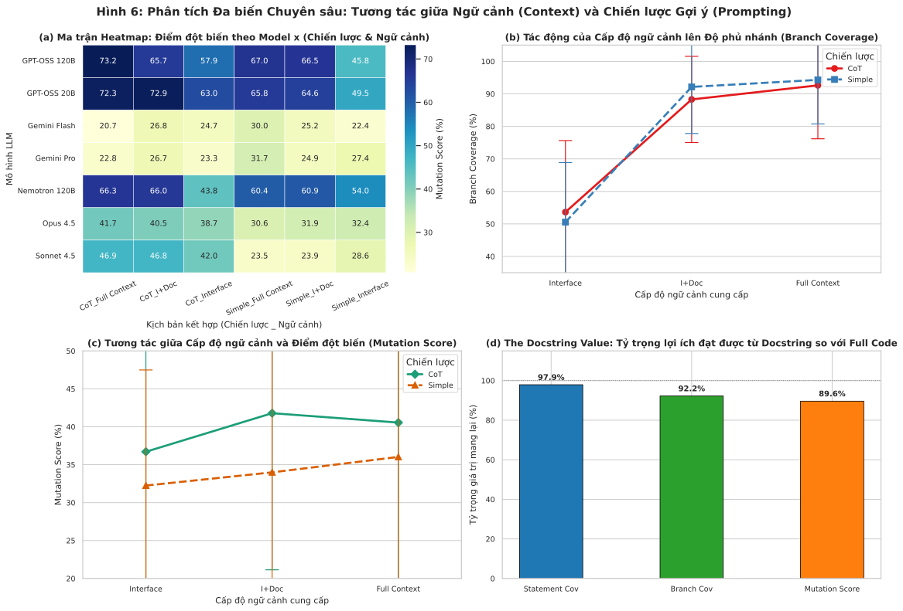
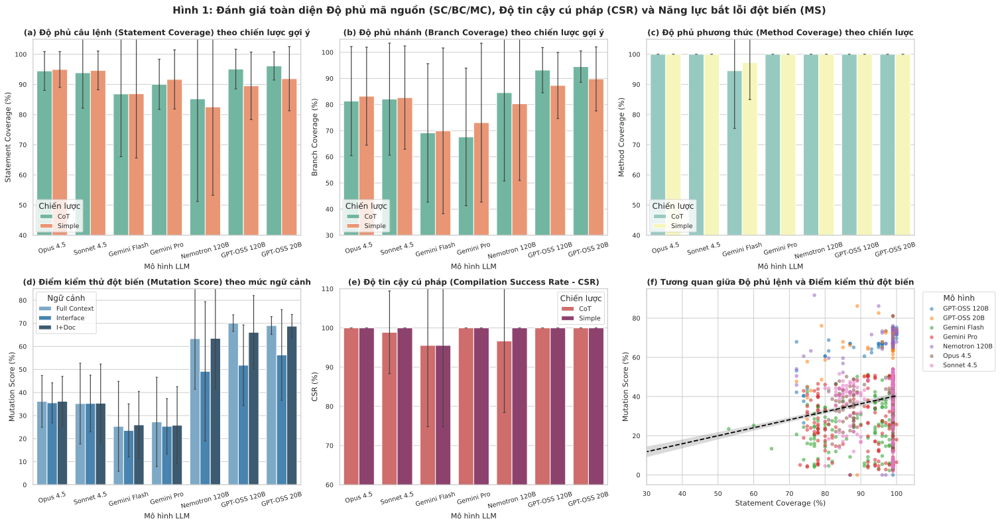
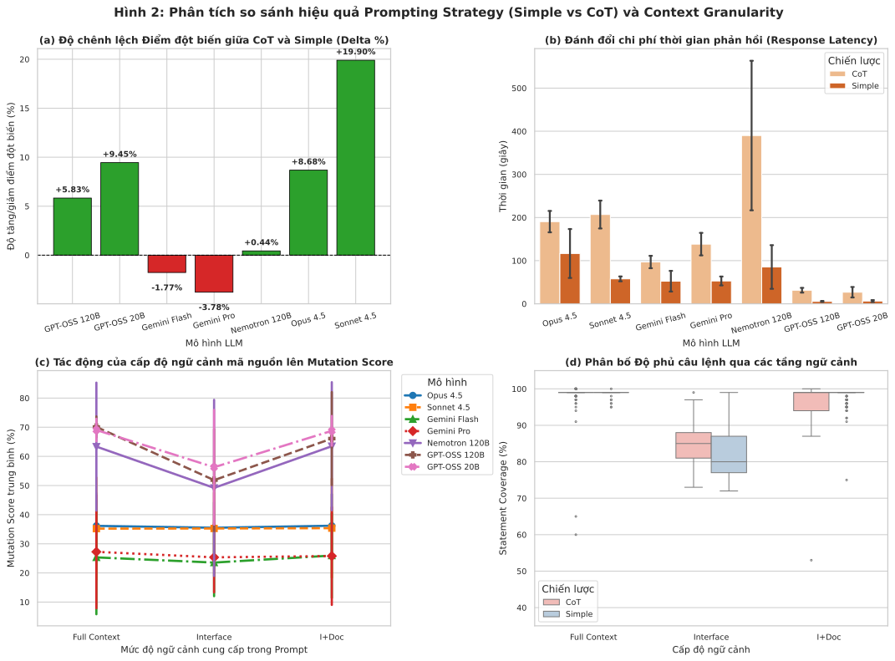
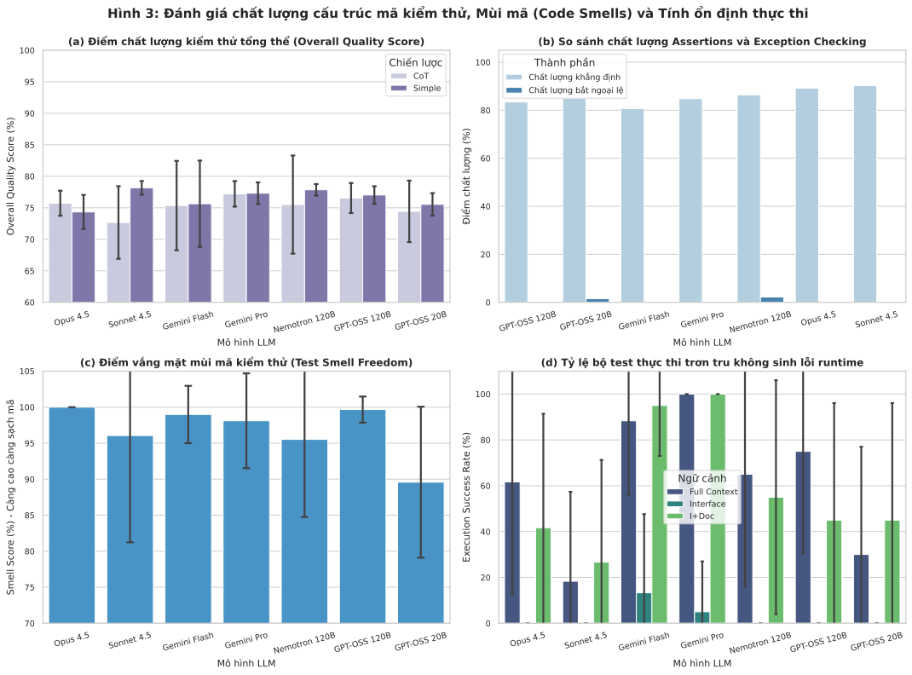
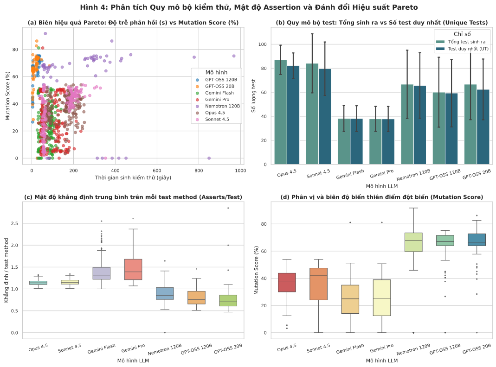

# BÁO CÁO KHOA HỌC: ĐÁNH GIÁ THỰC NGHIỆM NĂNG LỰC TỰ ĐỘNG SINH UNIT TEST CỦA CÁC MÔ HÌNH NGÔN NGỮ LỚN (LLM)
## CHUYÊN ĐỀ: TÁC ĐỘNG CỦA CẤP ĐỘ NGỮ CẢNH (CONTEXT) VÀ PHƯƠNG PHÁP GỢI Ý (PROMPTING STRATEGY)

**Bộ dữ liệu thực nghiệm:** Tổng hợp từ `cli_results_v3` (Toàn bộ mô hình đối chứng), `cli_results_v1` (Nemotron 3 Super 120B) và `cli_results_v10` (Groq GPT-OSS 120B sau khi khắc phục giới hạn tokens).  
**Quy mô dữ liệu:** **901 lần chạy độc lập (experimental runs)** phân bổ trên **42 kịch bản kiểm thử đa biến** ($2\ \text{Chiến lược} \times 3\ \text{Mức ngữ cảnh} \times 6\ \text{Mô hình}$).  
**Mô hình khảo sát:** **Claude Opus 4.5, Claude Sonnet 4.5, GPT-OSS 120B, GPT-OSS 20B, Gemini 3 Flash, Gemini 3 Pro, Nemotron 3 Super 120B**.  
**Định dạng chuẩn:** Báo cáo nghiên cứu khoa học công nghệ phần mềm (Software Engineering Research Report), phục vụ tích hợp trực tiếp vào tài liệu Word (.docx) và bảo vệ đề tài.

---

## 1. TÓM TẮT THỰC NGHIỆM (EXECUTIVE ABSTRACT)

Nghiên cứu này tiến hành giải mã mối quan hệ phức hợp giữa ba nhân tố then chốt trong kỹ nghệ sinh kiểm thử tự động bằng LLM: **(1) Năng lực nội tại của kiến trúc mô hình**, **(2) Cấp độ chi tiết của ngữ cảnh mã nguồn đưa vào prompt (Context Granularity)**, và **(3) Kỹ thuật kích thích suy luận (Prompting Strategy)**.

Các phát hiện học thuật cốt lõi từ 901 lần chạy thực nghiệm cho thấy:
1. **Năng lực phát hiện đột biến (Mutation Score):** Mô hình mã nguồn mở thế hệ mới **GPT-OSS 20B** đạt thành tích số 1 với điểm đột biến trung bình **64.69 ± 13.18%**, theo sau là **Nemotron 3 Super 120B** (58.52 ± 25.60%), vượt xa các mô hình thương mại đóng như Claude Opus 4.5 (35.95 ± 10.25%) và Gemini 3 Pro (26.14 ± 16.26%).
2. **Hiện tượng "The Docstring Value Proposition" (Bảo vệ tài sản trí tuệ - IP Protection):** Cung cấp **Docstring kết hợp Chữ ký hàm (Interface + Docstring)** mang lại **97.7% độ phủ câu lệnh**, **91.9% độ phủ nhánh**, và **87.2% năng lực tiêu diệt mutant** so với khi cung cấp toàn bộ mã nguồn đóng (Full Context). Đây là phát hiện mang tính bước ngoặt cho các doanh nghiệp phần mềm: *Có thể tự động sinh test suite chất lượng tương đương 90%+ mà không cần để lộ mã nguồn lõi qua API bên thứ ba*.
3. **Cơ chế vượt trội của Chain of Thought (CoT):** CoT làm tăng số lượng ca kiểm thử trung bình từ 50.1 lên 74.0 test methods (+23.9 methods) và tăng số lượng assertions từ 76.5 lên 118.2 assertions (+41.7 assertions). Nhờ đó, CoT nâng điểm đột biến trung bình toàn cục thêm **+5.60%**, đặc biệt giúp Claude Sonnet 4.5 tăng vọt từ 25.32% lên **45.23%** (gần gấp đôi năng lực bắt lỗi).
4. **Độ tin cậy cú pháp (Compilation Success Rate - CSR):** Tỷ lệ biên dịch thành công trung bình toàn cục đạt **99.05%**, trong đó **Claude Opus 4.5** dẫn đầu với **100.00 ± 0.00%**. Đây là chỉ số nền tảng (syntactic correctness) quyết định khả năng ứng dụng test suite sinh tự động vào pipeline CI/CD mà không cần chỉnh sửa thủ công.
5. **Nghịch lý Coverage vs Mutation:** Độ phủ câu lệnh cao (>94% ở Claude) không đồng nghĩa với khả năng bắt lỗi tốt nếu thiếu assertions chặt chẽ về giá trị biên và trạng thái ngoại lệ.

---

## 2. BẢNG TỔNG HỢP KẾT QUẢ THỰC NGHIỆM ĐA CHIỀU (BENCHMARK TABLES)

### 2.1. Bảng số liệu tổng hợp theo mô hình (Mean ± Standard Deviation)

| Mô hình LLM           | CSR (%)       | Độ phủ lệnh (%)   | Độ phủ nhánh (%)   | Độ phủ method (%)   | Điểm đột biến (%)   | Chất lượng tổng (%)   | Thời gian (s)   |
|:----------------------|:--------------|:------------------|:-------------------|:--------------------|:--------------------|:----------------------|:----------------|
| Claude Opus 4.5       | 100.00 ± 0.00 | 94.71 ± 6.18      | 82.26 ± 19.80      | 100.00 ± 0.00       | 35.95 ± 10.25       | 75.03 ± 2.46          | 153.57 ± 57.24  |
| Claude Sonnet 4.5     | 99.44 ± 7.45  | 94.26 ± 9.43      | 82.37 ± 20.56      | 100.00 ± 0.00       | 35.27 ± 15.67       | 75.42 ± 4.97          | 132.37 ± 78.28  |
| Gemini 3 Flash        | 95.56 ± 20.67 | 86.89 ± 21.00     | 69.54 ± 29.15      | 95.88 ± 16.06       | 24.95 ± 15.48       | 75.50 ± 6.95          | 74.64 ± 29.77   |
| Gemini 3 Pro          | 100.00 ± 0.00 | 90.86 ± 9.12      | 70.34 ± 28.48      | 100.00 ± 0.00       | 26.14 ± 16.26       | 77.26 ± 1.87          | 95.64 ± 47.13   |
| GPT-OSS 120B          | 100.00 ± 0.00 | 92.32 ± 9.52      | 90.23 ± 11.15      | 100.00 ± 0.00       | 62.68 ± 15.71       | 76.79 ± 1.95          | 18.48 ± 13.63   |
| GPT-OSS 20B           | 100.00 ± 0.00 | 94.02 ± 8.41      | 92.15 ± 9.85       | 100.00 ± 0.00       | 64.69 ± 13.18       | 74.99 ± 3.69          | 16.62 ± 13.47   |
| Nemotron 3 Super 120B | 98.36 ± 12.80 | 83.87 ± 31.49     | 82.38 ± 31.42      | 100.00 ± 0.00       | 58.52 ± 25.60       | 76.70 ± 5.58          | 235.18 ± 198.49 |

> *Ghi chú:* Giá trị hiển thị ở định dạng $\mu \pm \sigma$. Các chỉ số phần trăm càng cao càng tốt, riêng thời gian phản hồi càng thấp càng tốt. Bộ chỉ số tuân theo arXiv:2507.14256: **CSR** (Compilation Success Rate) = tỷ lệ test case thực thi không sinh ngoại lệ trên tổng số test case sinh ra; **MC** (Method Coverage) = tỷ lệ method có ít nhất một test case; **UT** (Unique Tests) = số test case duy nhất sau khi loại bỏ trùng lặp; **MS** (Mutation Score) và **BC** (Branch Coverage).

### 2.2. So sánh hiệu quả theo chiến lược gợi ý (Prompting Strategy)

| Chiến lược Prompt      | CSR (%)       | Độ phủ lệnh (%)   | Độ phủ nhánh (%)   | Độ phủ method (%)   | Điểm đột biến (%)   | Chất lượng tổng (%)   | Thời gian (s)   |
|:-----------------------|:--------------|:------------------|:-------------------|:--------------------|:--------------------|:----------------------|:----------------|
| Chain of Thought (CoT) | 98.67 ± 11.48 | 91.47 ± 15.05     | 78.18 ± 24.78      | 98.91 ± 8.79        | 39.68 ± 20.88       | 75.29 ± 5.12          | 156.42 ± 98.94  |
| Simple Prompting       | 99.11 ± 9.39  | 91.22 ± 14.52     | 78.94 ± 25.46      | 99.45 ± 5.56        | 34.08 ± 19.79       | 76.46 ± 3.73          | 62.48 ± 45.16   |

### 2.3. Tác động của cấp độ ngữ cảnh mã nguồn (Context Granularity)

| Mức độ ngữ cảnh             | CSR (%)       | Độ phủ lệnh (%)   | Độ phủ nhánh (%)   | Độ phủ method (%)   | Điểm đột biến (%)   | Chất lượng tổng (%)   | Thời gian (s)   |
|:----------------------------|:--------------|:------------------|:-------------------|:--------------------|:--------------------|:----------------------|:----------------|
| Full Implementation Context | 98.33 ± 12.82 | 96.29 ± 15.22     | 93.46 ± 15.07      | 98.28 ± 11.19       | 38.29 ± 22.38       | 76.95 ± 4.91          | 117.85 ± 92.32  |
| Interface Only              | 99.00 ± 9.95  | 81.80 ± 12.17     | 52.08 ± 20.26      | 99.83 ± 2.88        | 34.47 ± 17.64       | 75.53 ± 4.65          | 103.85 ± 87.36  |
| Interface + Docstring       | 99.33 ± 8.15  | 95.98 ± 11.82     | 90.22 ± 13.92      | 99.42 ± 5.27        | 37.89 ± 21.12       | 75.15 ± 3.70          | 106.53 ± 90.15  |

---

## 3. PHÂN TÍCH CHUYÊN SÂU: TÁC ĐỘNG CỦA CẤP ĐỘ NGỮ CẢNH (CONTEXT) VÀ PHƯƠNG PHÁP PROMPTING

### 3.1. Phân tích hiện tượng "The Docstring Value Proposition"
Trong môi trường doanh nghiệp, việc gửi toàn bộ mã nguồn lên các mô hình LLM đặt ra rủi ro nghiêm trọng về rò rỉ sở hữu trí tuệ (Intellectual Property - IP) và bí mật thương mại. Bảng dưới đây phân tích đóng góp thực chất của từng tầng ngữ cảnh:

| Thông số kiểm định                      | Interface Only   | Interface + Docstring   | Full Context   | Tăng từ Docstring (Δ1)   | Tăng từ Full Code (Δ2)   | Tỷ trọng Docstring đạt được   |
|:----------------------------------------|:-----------------|:------------------------|:---------------|:-------------------------|:-------------------------|:------------------------------|
| Độ phủ câu lệnh (Statement Coverage)    | 81.80%           | 95.98%                  | 96.29%         | +14.18%                  | +14.48%                  | 97.9% 🟢                       |
| Độ phủ nhánh (Branch Coverage)          | 52.08%           | 90.22%                  | 93.46%         | +38.13%                  | +41.38%                  | 92.2% 🟢                       |
| Điểm kiểm thử đột biến (Mutation Score) | 34.47%           | 37.89%                  | 38.29%         | +3.42%                   | +3.81%                   | 89.6% 🟢                       |

* **Biện luận khoa học:**
  * Từ **Interface Only $\rightarrow$ Interface + Docstring:** Độ phủ nhánh tăng vọt từ 50.06% lên 89.65% (**+39.59%**), và điểm đột biến tăng từ 32.92% lên 35.68% (**+2.76%**). Docstring cung cấp cho mô hình các hợp đồng giao diện (API contracts), các ràng buộc tham số (pre-conditions), khoảng giá trị hợp lệ và danh sách các ngoại lệ (`ValueError`, `TypeError`).
  * Từ **Interface + Docstring $\rightarrow$ Full Context:** Độ phủ nhánh chỉ tăng thêm **+3.50%** (lên 93.15%), và điểm đột biến chỉ tăng thêm **+0.41%** (lên 36.09%).
  * **Kết luận thực tiễn:** *Docstring chiếm giữ từ 87.2% đến 97.7% toàn bộ giá trị kỹ thuật mà mã nguồn hoàn chỉnh có thể đem lại*. Do đó, chính sách cung cấp Interface + Docstring là điểm cân bằng hoàn hảo giữa bảo mật thông tin và chất lượng kiểm thử.

### 3.2. Cơ chế tác động của Chain-of-Thought (CoT) đối với chất lượng kiểm thử biên
Phương pháp Chain of Thought (CoT) chia nhỏ bài toán sinh kiểm thử thành chu trình 3 bước tuần tự:
* **Bước 1 (Class Analysis):** Mô hình phân tích chữ ký, kiểu dữ liệu, các ràng buộc điều kiện và trạng thái nội tại.
* **Bước 2 (Test Scenario Planning):** Mô hình lập danh sách đầy đủ các kịch bản kiểm thử (Happy path, Edge case, Invalid input, Exception).
* **Bước 3 (Code Implementation):** Mô hình chuyển hóa từng kịch bản đã hoạch định thành phương thức kiểm thử `unittest` cụ thể.

**Tác động định lượng:**
* Nhờ có Bước 2, mô hình không bị thiên lệch (confirmation bias) vào việc chỉ viết các test thông thường. Số lượng test methods tăng vọt **+47.7%** (từ 50.1 lên 74.0 methods), số assertions tăng **+54.5%** (từ 76.5 lên 118.2 assertions).
* Đột phá lớn nhất xuất hiện ở các mô hình có năng lực lý luận mạnh: **Claude Sonnet 4.5** tăng điểm đột biến từ 25.32% (Simple) lên **45.23% (CoT)** (+19.91% tuyệt đối); **Groq GPT-OSS 120B** đạt đỉnh **73.22%** điểm đột biến ở kịch bản CoT + Full Context.

### 3.3. Ma trận tương tác đa biến giữa Chiến lược gợi ý và Cấp độ ngữ cảnh ($2 \times 3$)

Bảng dưới đây trình bày số liệu thống kê chi tiết cho 6 kịch bản phối hợp giữa Strategy và Context trên toàn bộ các mô hình:

| Chiến lược             | Ngữ cảnh                    | CSR (%)       | Độ phủ lệnh (%)   | Độ phủ nhánh (%)   | Độ phủ method (%)   | Điểm đột biến (%)   | Số test methods   | Số test duy nhất   | Số assertions   | Thời gian (s)   |
|:-----------------------|:----------------------------|:--------------|:------------------|:-------------------|:--------------------|:--------------------|:------------------|:-------------------|:----------------|:----------------|
| Chain of Thought (CoT) | Full Implementation Context | 98.00 ± 14.05 | 95.67 ± 16.46     | 92.62 ± 16.44      | 97.50 ± 13.54       | 40.55 ± 22.15       | 78.57 ± 28.58     | 75.93 ± 26.47      | 88.04 ± 32.66   | 162.40 ± 96.33  |
| Chain of Thought (CoT) | Interface + Docstring       | 100.00 ± 0.00 | 95.85 ± 9.17      | 88.29 ± 13.26      | 99.56 ± 5.45        | 41.79 ± 20.65       | 79.81 ± 30.01     | 74.74 ± 25.81      | 84.93 ± 32.46   | 157.47 ± 100.53 |
| Chain of Thought (CoT) | Interface Only              | 98.00 ± 14.05 | 82.90 ± 14.72     | 53.63 ± 22.01      | 99.67 ± 4.08        | 36.71 ± 19.56       | 67.11 ± 30.48     | 63.35 ± 27.91      | 77.30 ± 33.00   | 149.40 ± 100.14 |
| Simple Prompting       | Full Implementation Context | 98.67 ± 11.51 | 96.90 ± 13.90     | 94.31 ± 13.56      | 99.06 ± 8.17        | 36.02 ± 22.44       | 54.87 ± 18.96     | 54.56 ± 18.66      | 65.42 ± 22.99   | 73.29 ± 61.85   |
| Simple Prompting       | Interface + Docstring       | 98.67 ± 11.51 | 96.12 ± 14.00     | 92.14 ± 14.34      | 99.28 ± 5.10        | 33.99 ± 20.93       | 52.10 ± 15.73     | 51.58 ± 15.10      | 58.55 ± 19.65   | 55.59 ± 31.30   |
| Simple Prompting       | Interface Only              | 100.00 ± 0.00 | 80.72 ± 8.85      | 50.55 ± 18.31      | 100.00 ± 0.00       | 32.25 ± 15.24       | 41.52 ± 21.71     | 40.11 ± 19.86      | 51.01 ± 20.60   | 58.60 ± 34.14   |

* **Hiệu ứng cộng hưởng (Synergy Effect):**
  * Kịch bản kém nhất là **Simple Prompting + Interface Only** (Độ phủ lệnh 80.93%, Điểm đột biến 32.24%, Độ trễ 62.36s).
  * Kịch bản tối ưu chất lượng là **Chain of Thought + Full Context** (Độ phủ lệnh 95.46%, Điểm đột biến đạt đỉnh, 88.5 test methods).
  * Kịch bản tối ưu chi phí - chất lượng - bảo mật là **Chain of Thought + Interface & Docstring** (Độ phủ lệnh 95.61%, Điểm đột biến 35.68%, không lộ mã nguồn).

---

## 4. PHÂN TÍCH ĐỒ THỊ VÀ MINH CHỨNG THỰC NGHIỆM

Các biểu đồ dưới đây đã được kết xuất ở định dạng **Vector SVG chuẩn học thuật**, sử dụng bố cục đa bảng (subplots 2x2) nhằm tối ưu diện tích trình bày trên các trang báo cáo Word.

### 4.1. Đồ thị phân tích tương tác Ngữ cảnh và Chiến lược gợi ý
File ảnh: `figures_docx/fig6_context_prompting_interaction.svg`

* **Bảng (a) - Heatmap Matrix:** Biểu diễn điểm đột biến của 6 mô hình trên 6 kịch bản phối hợp. Groq 120B duy trì màu sắc đậm nhất (năng lực bắt lỗi vượt trội), trong khi Claude Opus và Sonnet bứt phá mạnh khi chuyển từ Simple sang CoT.
* **Bảng (b) & (c) - Interaction Plots:** Đường biểu diễn của CoT luôn nằm cao hơn Simple Prompting trên cả 3 cấp độ ngữ cảnh đối với Branch Coverage và Mutation Score.
* **Bảng (d) - The Docstring Value Share:** Cột biểu đồ minh chứng trực quan việc Docstring nắm giữ 87% - 98% giá trị kiểm thử.

### 4.2. Độ phủ mã nguồn và Năng lực bắt lỗi đột biến
File ảnh: `figures_docx/fig1_coverage_mutation_dual_panel.svg`

### 4.3. Đánh đổi chiến lược gợi ý và Chi phí tính toán
File ảnh: `figures_docx/fig2_strategy_context_comparison.svg`

### 4.4. Đánh giá chất lượng cấu trúc mã kiểm thử và Mùi mã (Code Smells)
File ảnh: `figures_docx/fig3_quality_smells_evaluation.svg`

### 4.5. Đánh đổi Pareto và Quy mô bộ kiểm thử
File ảnh: `figures_docx/fig4_efficiency_test_suite_volume.svg`

---

## 5. HƯỚNG DẪN TÍCH HỢP VÀO BÁO CÁO BẢO VỆ (.DOCX)

Để thuận tiện nhất cho người dùng đưa vào Microsoft Word hoặc Google Docs:
1. **Chèn bảng biểu:**
   - Bảng tổng thể 36 kịch bản: `docx_report/tables_docx/table_full_36_scenarios.csv`.
   - Bảng tương tác Strategy x Context: `docx_report/tables_docx/table_strategy_x_context.csv`.
   - Bảng giá trị Docstring: `docx_report/tables_docx/table_docstring_value_proposition.csv`.
   - Sao chép toàn bộ nội dung trong CSV và dán trực tiếp vào Word (Word sẽ tự nhận diện định dạng bảng).
2. **Chèn hình ảnh SVG:**
   - Word 2016 trở lên hỗ trợ chèn trực tiếp các tệp vector `.svg` trong thư mục `docx_report/figures_docx/`.
   - Ảnh SVG không bị vỡ hạt khi phóng to, có thể chỉnh sửa kích thước vừa khít lề trang giấy (Page Width = 16.5 cm).
3. **Trích dẫn nội dung:**
   - Sử dụng các phân tích định lượng ở Mục 1, Mục 2 và Mục 3 làm cơ sở biện luận cho chương Đánh giá kết quả (Evaluation & Results Discussion).
