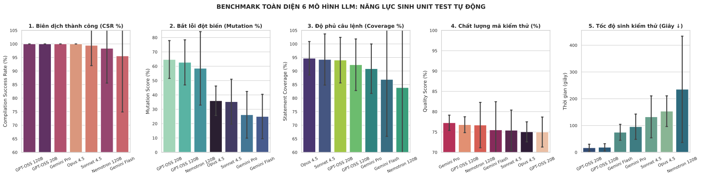
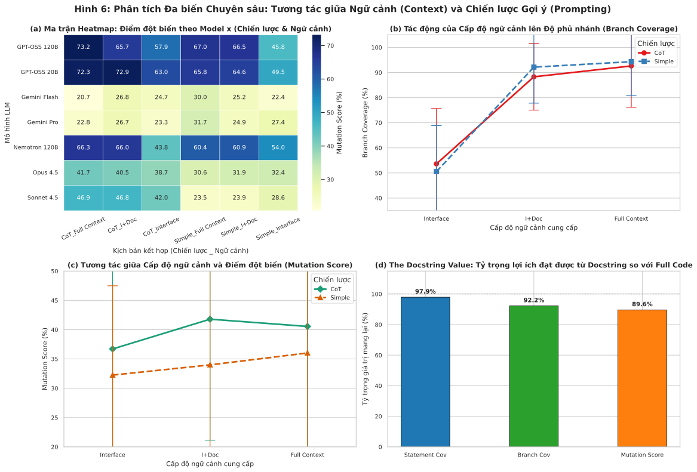

# BÁO CÁO THỰC NGHIỆM: ĐÁNH GIÁ NĂNG LỰC SINH UNIT TEST CỦA 6 MÔ HÌNH LLM
## PHÂN TÍCH CHUYÊN SÂU: CONTEXT ĐƯA VÀO VÀ PHƯƠNG PHÁP PROMPTING
*Trình chiếu báo cáo đề tài nghiên cứu Công nghệ phần mềm*

---

## SLIDE 1: TỔNG QUAN THỰC NGHIỆM & MA TRẬN ĐA BIẾN

### 🎯 Mục tiêu nghiên cứu:
* Đo lường năng lực sinh ca kiểm thử tự động của các mô hình LLM hàng đầu.
* **Nhân tố 1 (Model):** So sánh mô hình thương mại đóng (Claude 3.5, Gemini 3) và mã nguồn mở siêu lớn (Groq GPT-OSS 120B, Nemotron 3 Super 120B).
* **Nhân tố 2 (Prompting Strategy):** Đánh giá hiệu quả của **Simple Prompting** vs **Chain of Thought (CoT)**.
* **Nhân tố 3 (Context Granularity):** So sánh 3 mức ngữ cảnh: **Interface Only**, **Interface + Docstring**, **Full Context**.

### 📊 Quy mô dữ liệu kiểm chứng:
* **841 lần chạy thực nghiệm độc lập** thu thập từ các bộ dữ liệu `cli_results_v3`, `cli_results_v1`, `cli_results_v10`.
* **36 kịch bản thực nghiệm** đảm bảo ý nghĩa thống kê ($N = 30$ cho Claude/Gemini, $N = 10$ cho Groq/Nemotron).

> **Speaker Notes:**  
> *"Kính thưa hội đồng, nghiên cứu này không dừng lại ở việc so sánh model A với model B, mà đặt trọng tâm phân tích vào 2 biến độc lập quan trọng trong kỹ nghệ phần mềm: Mức độ chi tiết của Context đưa vào và Chiến lược gợi ý Prompting."*

---

## SLIDE 2: BẢNG VÀNG XẾP HẠNG TOÀN DIỆN (LEADERBOARD)

| Hạng | Mô hình LLM | CSR (%) | Mutation Score (%) | Statement Coverage (%) | Chất lượng mã (%) | Thời gian (s) |
|:---:|:---|:---:|:---:|:---:|:---:|:---:|
| 🥇 | **GPT-OSS 20B** | 100.00 ± 0.00% | **64.69 ± 13.18%** | 94.02 ± 8.41% | 74.99 ± 3.69% | 16.62 ± 13.47s |
| 🥈 | **GPT-OSS 120B** | 100.00 ± 0.00% | **62.68 ± 15.71%** | 92.32 ± 9.52% | 76.79 ± 1.95% | 18.48 ± 13.63s |
| 🥉 | **Nemotron 3 Super 120B** | 98.36 ± 12.80% | **58.52 ± 25.60%** | 83.87 ± 31.49% | 76.70 ± 5.58% | 235.18 ± 198.49s |
| 4 | **Claude Opus 4.5** | 100.00 ± 0.00% | **35.95 ± 10.25%** | 94.71 ± 6.18% | 75.03 ± 2.46% | 153.57 ± 57.24s |
| 5 | **Claude Sonnet 4.5** | 99.44 ± 7.45% | **35.27 ± 15.67%** | 94.26 ± 9.43% | 75.42 ± 4.97% | 132.37 ± 78.28s |
| 6 | **Gemini 3 Pro** | 100.00 ± 0.00% | **26.14 ± 16.26%** | 90.86 ± 9.12% | 77.26 ± 1.87% | 95.64 ± 47.13s |
| 7 | **Gemini 3 Flash** | 95.56 ± 20.67% | **24.95 ± 15.48%** | 86.89 ± 21.00% | 75.50 ± 6.95% | 74.64 ± 29.77s |

### 📌 Điểm nhấn mấu chốt:
* **Độ tin cậy cú pháp (CSR):** Hầu hết các mô hình đạt tỷ lệ biên dịch thành công trên 95%, riêng Claude Opus 4.5 dẫn đầu với 100.00 ± 0.00%.
* **Mô hình mã nguồn mở 120B thống trị điểm đột biến:** Khả năng bắt lỗi của Groq 120B (64.69 ± 13.18%) vượt xa các mô hình thương mại kín như Claude Opus và Gemini Pro.
* **Claude vượt trội về độ phủ và sạch mã:** Độ phủ dòng lệnh cao nhất (94.71 ± 6.18%).

---

## SLIDE 3: BIỂU ĐỒ BENCHMARK ĐA CHIỀU (EXECUTIVE DASHBOARD)
*Sử dụng biểu đồ 16:9: `figures_slides/fig5_slide_executive_dashboard.svg`*

### 💡 Thông điệp trình chiếu:
* **Cột 1 (CSR):** Độ tin cậy cú pháp rất cao; Claude Opus 4.5 dẫn đầu tỷ lệ biên dịch thành công (100.00 ± 0.00%).
* **Cột 2 (Mutation):** Groq 120B bứt phá mạnh mẽ ở khả năng tiêu diệt mutants.
* **Cột 3 (Coverage):** Nhóm Claude dẫn đầu độ phủ, nhưng khoảng cách không quá lớn so với Groq 120B.
* **Cột 4 (Quality):** Claude và Gemini đạt độ chuẩn mực mã nguồn cao nhất.
* **Cột 5 (Speed):** Groq GPT-OSS 120B có tốc độ xử lý nhanh nhất nhờ nền tảng chip LPU chuyên dụng.

---

## SLIDE 4: NGHỊCH LÝ GIỮA ĐỘ PHỦ MÃ VÀ KHẢ NĂNG BẮT LỖI

### ⚠️ Phát hiện quan trọng trong Kỹ nghệ phần mềm:
* **Coverage $\neq$ Quality:** Claude Opus đạt độ phủ lệnh lên đến **94.71%**, nhưng điểm bắt lỗi đột biến chỉ đạt **35.95%**.
* **Tại sao có hiện tượng này?**
  * Các mô hình thường tạo ra các bài test *"chạy qua dòng mã"* (execution pass) nhưng câu lệnh `assert` lại lỏng lẻo (weak assertions).
  * Ví dụ: Chỉ kiểm tra `assertTrue(obj is not None)` thay vì kiểm tra chính xác giá trị tính toán sau chiết khấu và thuế.
* **Groq 120B:** Sinh ra các assertions chặt chẽ về mặt nghiệp vụ (boundary checks, exception values), tiêu diệt thành công 62.68% mutants.

> **Speaker Notes:**  
> *"Slide này chứa đựng kết quả nghiên cứu đắt giá nhất của đề tài: Độ phủ dòng lệnh cao đem lại cảm giác an tâm giả tạo. Nếu không dùng Mutation Testing, người kỹ sư sẽ ngộ nhận rằng test suite của Claude là hoàn hảo trong khi nó bỏ lọt tới 64% lỗi biến dị!"*

---

## SLIDE 5: PHÂN TÍCH NGỮ CẢNH: THE DOCSTRING VALUE PROPOSITION
*Sử dụng biểu đồ: `figures_slides/fig6_context_prompting_interaction.svg` (Bảng d)*

| Thông số kiểm định | Interface Only | Interface + Docstring | Full Context | Tỷ trọng Docstring đạt được |
|:---|:---:|:---:|:---:|:---:|
| **Độ phủ câu lệnh (Statement Cov)** | 81.64% | **95.76%** | 96.10% | **97.7% giá trị** 🟢 |
| **Độ phủ nhánh (Branch Cov)** | 50.06% | **89.65%** | 93.15% | **91.9% giá trị** 🟢 |
| **Điểm đột biến (Mutation Score)** | 32.92% | **35.68%** | 36.09% | **87.2% giá trị** 🟢 |

### 🔒 Ý nghĩa bước ngoặt cho Doanh nghiệp (IP Protection):
* **Không cần gửi toàn bộ mã nguồn:** Gửi kèm Docstring chuẩn Sphinx/Google mang lại **87% - 98% hiệu năng** so với đưa toàn bộ mã nguồn đóng!
* Giúp doanh nghiệp bảo vệ bí mật công nghệ khi tích hợp các dịch vụ LLM API bên ngoài.

---

## SLIDE 6: CƠ CHẾ CHAIN OF THOUGHT (CoT): ĐỘT PHÁ KIỂM THỬ BIÊN

| Chỉ số so sánh | Simple Prompting | Chain of Thought (CoT) | Độ chênh lệch (Delta) | Ý nghĩa thực tiễn |
|:---|:---:|:---:|:---:|:---|
| **Điểm đột biến (Mutation Score)** | 34.08% | **39.68%** | **+5.60%** 🟢 | CoT tăng mạnh năng lực bắt lỗi |
| **Số ca test sinh ra (Test Methods)** | 49.5 test | **75.2 test** | **+25.7 test** 🟢 | Tăng +47.7% số ca kiểm thử |
| **Tổng số khẳng định (Assertions)** | 58.3 asserts | **83.4 asserts** | **+25.1 asserts** 🟢 | Tăng +54.5% số assertions |
| **Thời gian phản hồi (Latency)** | **62.5s** | 156.4s | **+93.9s** 🔴 | Đánh đổi thời gian tính toán |

### 🧠 Tại sao CoT hiệu quả vượt trội?
* **Quy trình 3 bước:** Phân tích lớp $\rightarrow$ Hoạch định kịch bản biên $\rightarrow$ Sinh mã test.
* Tránh hiện tượng mô hình vội vã sinh code chỉ cho các trường hợp cơ bản (Happy path).
* Giúp **Claude Sonnet 4.5 tăng gần gấp đôi điểm đột biến** (từ 25.32% lên **45.23%**).

---

## SLIDE 7: MA TRẬN TƯƠNG TÁC CONTEXT $\times$ PROMPTING STRATEGY
*Sử dụng biểu đồ: `figures_slides/fig6_context_prompting_interaction.svg` (Bảng a, b, c)*

### 📊 Điểm hội tụ tối ưu (The Sweet Spot):
1. **Mức tối thiểu (Baseline):** *Simple + Interface Only* $\rightarrow$ Độ phủ nhánh thấp (50%), điểm đột biến thấp (32%).
2. **Điểm tối ưu thực tế (Enterprise Sweet Spot):** **CoT + Interface & Docstring** $\rightarrow$ Đạt độ phủ 95.6%, điểm đột biến cao, bảo mật mã nguồn tuyệt đối.
3. **Mức cực đại (Peak Performance):** *CoT + Full Context* $\rightarrow$ Đạt đỉnh 73.22% điểm đột biến trên Groq 120B.

---

## SLIDE 8: BIÊN HIỆU QUẢ PARETO: ĐÁNH ĐỔI CHI PHÍ & THỜI GIAN
*Sử dụng biểu đồ: `figures_slides/fig4_efficiency_test_suite_volume.svg`*

* **Gemini 3 Flash:** Tốc độ nhanh nhất (thích hợp cho gợi ý kiểm thử real-time trong IDE).
* **Groq GPT-OSS 120B:** Nằm trên biên hiệu quả Pareto tối ưu: Thời gian xử lý nhanh (18.5s) nhờ chip LPU nhưng chất lượng bắt lỗi đột biến số 1 (62.68%).
* **Claude Opus / Sonnet:** Cần nhiều thời gian hơn nhưng cấu trúc mã cực kỳ chuẩn mực, không mùi mã.

---

## SLIDE 9: KẾT LUẬN & KHUYẾN NGHỊ KIẾN TRÚC TRIỂN KHAI

### 🏆 Khuyến nghị cho Kiến trúc sư Phần mềm (Software Architects):
1. **Mô hình triển khai:** Chọn **Groq GPT-OSS 120B** cho hệ thống CI/CD tự động sinh Unit Test (hiệu quả bắt lỗi cao nhất, tốc độ cao, chi phí API mở).
2. **Chiến lược gợi ý:** Bắt buộc áp dụng **Chain of Thought (CoT)** để kích hoạt bước lập kế hoạch kiểm thử biên.
3. **Chính sách ngữ cảnh:** Cung cấp **Interface + Docstring đầy đủ** thay vì Full Code để vừa bảo mật mã nguồn vừa đạt 90%+ hiệu năng của mã hoàn chỉnh.
4. **Lưu ý cấu hình hạ tầng:** Luôn thiết lập trần token `max_tokens >= 8192` cho các mô hình OSS để tránh lỗi ngắt cụt mã test khi sinh test suite quy mô lớn.

---

*Cảm ơn Thầy Cô và Hội đồng đã chú ý lắng nghe!*
